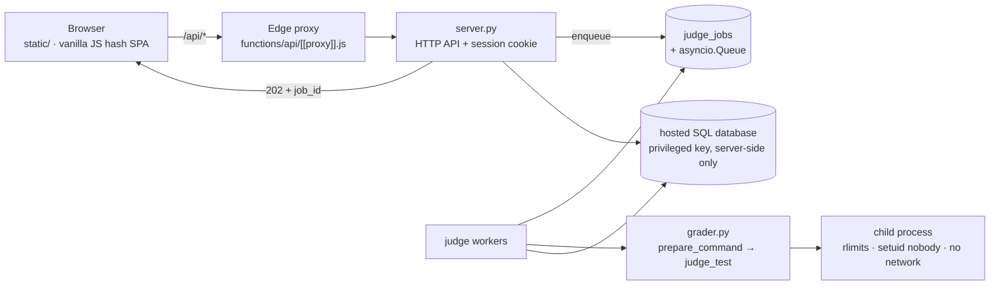

<div align="center">

# Newbiegrader

**An online judge for Thai competitive-programming instruction — strict, transparent, contest-ready.**

[](https://github.com/n3wbiekkkk/Newbiegrader/actions/workflows/ci.yml)


[Live demo](https://newbiegrader.pages.dev) · [Report a bug](../../issues) · [Adding a problem](#-adding-a-problem)

</div>

> Submit Python / C / C++ and get judged automatically under real time limits, real memory limits, and an
> undisclosed test set — with contests, submission history, leaderboards, and plagiarism tooling for teachers.

## Why Newbiegrader

| | |
|---|---|
| **Real limits, not estimates** | Wall-clock timeout plus `RLIMIT_CPU`; memory verdicts from measured peak RSS. Interpreted runtimes get a documented allowance (×2.5) so students are judged on their algorithm, not their runtime's per-value overhead, while C/C++ face the full declared limit. Full verdict set: `AC · WA · TLE · MLE · OLE · RE · CE` |
| **801 undisclosed tests** | 55 problems with 10–18 tests each. Students only ever see the declared samples — hidden input, expected output and diffs never leave the server (redacted both in responses and before database writes) |
| **Async judging that never loses work** | `POST /api/submit` returns `202 + job_id` and judges in the background. Reloads, navigation and even server restarts neither lose the run nor its verdict — just poll and pick it back up |
| **Ready to run contests** | Codeforces-style rounds: pre-contest registration, problems unlock at start, frozen scoreboard mid-round, contest scores kept off the permanent ranking |
| **Teacher tooling** | Full submission history with source (owner + admin only), per-problem statistics, batch rejudge, winnowing-based similarity detection, broken-problem reports |
| **Students never lose work** | Per-problem draft autosave, in-flight runs remembered across reloads, keyboard operable, dark mode at WCAG AA contrast |

## Architecture



| Layer | What |
|---|---|
| Judging engine | `grader.py` — standalone, Python standard library only (`v2.0.0`) |
| API + job queue | `server.py` — HTTP API, durable queue, per-account quotas, reveal policy |
| Frontend | `static/` — plain HTML/CSS/JS, **no build step** |
| Problems | `problems/<id>/` — `config.json` + `statement.pdf/md` + `tests/*.in\|*.out` (numeric `no` drives ordering, search and numeric URLs) |
| Reference solutions | `examples/<id>_ref.py` — single source of truth when generating tests |
| Database | `supabase/schema.sql` — schema plus append-only migrations (safe to re-run) |

## Getting started (local)

```bash
pip3 install -r requirements.txt
python3 server.py                 # http://127.0.0.1:8000 serves both API and frontend
```

Browsing problems and using the CLI need neither an account nor a database. A hosted SQL database (apply
`supabase/schema.sql` in its SQL editor) is only required for history, statistics, leaderboards and contests.

```bash
python3 grader.py list
python3 grader.py run warpz examples/warpz_ref.py
python3 grader.py run mana_crystal examples/mana_crystal_ref.py --strict --stop-on-fail
```

## Verifying a change

```bash
python3 -m compileall -q grader.py server.py tools tests
node --check static/app.js && node tools/check_frontend.js && node tools/check_styles.js
python3 tools/validate_problem.py          # 55 problems: config, tests, samples, reference AC
python3 -m unittest discover -s tests -v   # no live server or database needed
```

The same sequence runs in CI on every push and pull request to `main`.

## Adding a problem

1. Drop the statement as `problems/<id>/statement.pdf` (`id` is lowercase snake_case)
2. Write a Thai `statement.md`: story + `## Input` + `## Output` + `## ตัวอย่าง` (fenced `input:`/`output:` blocks) + `## Limits` — no hints or solutions
3. Typeset the PDF with `python3 tools/make_statement_tex.py <id>` and visually check every page
4. Fill in `config.json` (copy a neighboring one), add 10+ tests in `tests/NN.in|NN.out` (statement samples byte-identical + edges + seeded randoms + max constraints), and `examples/<id>_ref.py`
5. Assign the problem number with `python3 tools/number_problems.py --assign` (numbers run easy → hard, unique)
6. `python3 grader.py run <id> examples/<id>_ref.py` must be fully `ACCEPTED`, a wrong solution must fail, and `python3 tools/validate_problem.py <id>` must report 0 FAIL

## Deploy

- **Backend:** `git push <backend-remote> HEAD:deploy` (Docker: Python 3.11 + gcc/g++)
- **Frontend:** push `main` — Pages publishes `static/` automatically; `/api/*` goes through the same-origin proxy so the login cookie stays first-party
- Bump the `?v=N` stamp in `static/index.html` every time a versioned asset changes

## Contributing

Two invariants are non-negotiable:

1. **One judge only.** All judging passes through `grader.run_one` / `grader.judge_test` / `grader.prepare_command` — never judge inside a request handler.
2. **Never disclose test data.** Anything carrying test data passes through `_redact_results()`, both on the response path and on the path to the database.

To be listed in the Team table below, open a pull request (the current contributor's scope is an example of the expected granularity).

## Team

| Role | Person | Scope |
|---|---|---|
| Maintainer | [@n3wbiekkkk](https://github.com/n3wbiekkkk) | Repository owner: judging engine, HTTP API, frontend, problem set, deployment |
| Contributors | [@Piyaph4t](https://github.com/Piyaph4t) | Judge-worker split (`judge_runner.py`/`worker.py`), queue test coverage |

Report security issues directly through the maintainer's profile instead of opening a public issue.

## License

Copyright (C) 2026 Newbiegrader contributors. This program is free software: you may redistribute it
and/or modify it under the terms of the **GNU Affero General Public License, version 3 or later**, as
published by the Free Software Foundation. The full text is in [`LICENSE`](LICENSE).

**Network use (AGPL section 13).** Operating a modified version and letting users interact with it over
a network requires offering those users the Corresponding Source of the running version. For this
deployment that source is <https://github.com/n3wbiekkkk/Newbiegrader>, linked from the footer of
every page; any other instance must make an equivalent offer.

**Bundled and linked third-party components.** The Thai typeface used to typeset statement PDFs is
bundled with the repository and is licensed under the SIL Open Font License 1.1; the licence text
ships beside the font files (`tools/fonts/OFL.txt`). Two web typefaces are loaded at runtime from a
public font CDN under the same licence and are not redistributed here. Language-level dependencies are
pinned in `requirements.txt` and are not vendored into this repository.

**Warranty.** Distributed in the hope that it will be useful, but without any warranty; without even
the implied warranty of merchantability or fitness for a particular purpose (licence sections 15–16).

**Trademarks.** The licence covers copyright only; it grants no rights in the project name, logo or
domains. Contributions are accepted on the understanding that they may be distributed under the same
licence.
