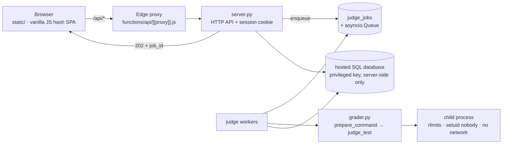

<div align="center">

# Newbiegrader

**เว็บสนามสอบเขียนโปรแกรมสำหรับเด็กไทย — ตรวจโหด โปร่งใส พร้อมแข่งจริง**

[](https://github.com/n3wbiekkkk/Newbiegrader/actions/workflows/ci.yml)


[เข้าใช้งานจริง](https://newbiegrader.pages.dev) · [รายงานบั๊ก](../../issues) · [วิธีลงโจทย์](#-adding-a-problem)

</div>

> ส่งโค้ด Python / C / C++ แล้วระบบตรวจให้อัตโนมัติภายใต้ลิมิตเวลาจริง หน่วยความจำจริง และชุดเทสต์ลับที่ไม่เปิดเผย —
> พร้อมโหมดคอนเทสต์ ประวัติการส่ง ลีดเดอร์บอร์ด และเครื่องมือจับโค้ดก็อปสำหรับครู

## ทำไมต้อง Newbiegrader

| | |
|---|---|
| **ลิมิตจริง ไม่ใช่ประมาณ** | จับเวลาด้วย wall-clock + `RLIMIT_CPU` หน่วยความจำวัดจาก peak RSS ภาษาตีความได้ allowance ตามเอกสาร (×2.5) ส่วน C/C++ โดนลิมิตเต็มตามโจทย์ประกาศ เวิร์ดิกต์ครบ `AC · WA · TLE · MLE · OLE · RE · CE` |
| **เทสต์ลับ 801 ข้อ** | โจทย์ 55 ข้อ ข้อละ 10–18 เทสต์ นักเรียนเห็นแค่ตัวอย่างสาธารณะ input/expected/diff ของเทสต์ลับไม่เคยออกจากเซิร์ฟเวอร์ (redact ทั้งตอนตอบและตอนเก็บลงฐานข้อมูล) |
| **ตรวจแบบ async ไม่หาย** | `POST /api/submit` ตอบ `202 + job_id` แล้วตรวจเบื้องหลัง รีเฟรช เปลี่ยนหน้า หรือเซิร์ฟเวอร์รีสตาร์ท งานก็ไม่หาย กลับมา poll ต่อได้ |
| **พร้อมจัดแข่ง** | คอนเทสต์สไตล์ Codeforces: ลงทะเบียนก่อนแข่ง โจทย์เปิดเมื่อเริ่ม ตรึงสกอร์บอร์ดระหว่างแข่ง คะแนนในแข่งไม่ปนบอร์ดกลาง |
| **เครื่องมือครู** | ประวัติทุกการส่งพร้อมโค้ด (เจ้าของ + แอดมินเท่านั้น) สถิติรายข้อ rejudge ยกชุด ตรวจจับโค้ดคล้าย (winnowing) รับรีพอร์ตโจทย์พัง |
| **ฝั่งนักเรียนไม่เสียงาน** | ดราฟต์โค้ดเซฟอัตโนมัติรายข้อ งานที่ตรวจไม่จบจำไว้กลับมาอ่านต่อได้ รองรับคีย์บอร์ด โหมดมืดผ่าน WCAG AA |

## สถาปัตยกรรม



| ชั้น | ของ |
|---|---|
| เอนจินตัดสิน | `grader.py` — สแตนด์อโลน ใช้แค่ Python standard library (`v2.0.0`) |
| API + คิวงาน | `server.py` — HTTP API, คิว durable, โควตารายบัญชี, นโยบายเฉลย |
| หน้าเว็บ | `static/` — HTML/CSS/JS ล้วน **ไม่มี build step** |
| โจทย์ | `problems/<id>/` — `config.json` + `statement.pdf/md` + `tests/*.in|*.out` (เลขโจทย์ `no` ใช้เรียง/ค้นหา/เปิดด้วยเลข) |
| เฉลยอ้างอิง | `examples/<id>_ref.py` — single source of truth ตอนสร้างเทสต์ |
| ฐานข้อมูล | `supabase/schema.sql` — schema + migration แบบ append-only (รันซ้ำปลอดภัย) |

## เริ่มใช้งาน (local)

```bash
pip3 install -r requirements.txt
python3 server.py                 # http://127.0.0.1:8000 ทั้ง API และหน้าเว็บ
```

ดูโจทย์กับใช้ CLI ไม่ต้องมีบัญชีหรือฐานข้อมูล ฐานข้อมูลแบบโฮสต์ (รัน `supabase/schema.sql` ใน SQL Editor)
จำเป็นเฉพาะ history / สถิติ / ลีดเดอร์บอร์ด / คอนเทสต์

```bash
python3 grader.py list
python3 grader.py run warpz examples/warpz_ref.py
python3 grader.py run mana_crystal examples/mana_crystal_ref.py --strict --stop-on-fail
```

## ตรวจก่อน commit

```bash
python3 -m compileall -q grader.py server.py tools tests
node --check static/app.js && node tools/check_frontend.js && node tools/check_styles.js
python3 tools/validate_problem.py          # 55 ข้อ: config, เทสต์, ตัวอย่าง, ref ต้อง AC
python3 -m unittest discover -s tests -v  # ไม่ต้องมีเซิร์ฟเวอร์หรือฐานข้อมูลจริง
```

ชุดเดียวกันนี้รันใน CI ทุก push/PR เข้า `main`

## Adding a problem

1. วางโจทย์เป็น `problems/<id>/statement.pdf` (`id` snake_case ตัวเล็ก)
2. เขียน `statement.md` ภาษาไทย: เรื่องราว + `## Input` + `## Output` + `## ตัวอย่าง` (บล็อก `input:`/`output:`) + `## Limits` — ห้ามมีเฉลย/ใบ้
3. ปั้น PDF ด้วย `python3 tools/make_statement_tex.py <id>` แล้วเปิดดูทุกข้อ
4. เติม `config.json` (ดู `config.json` ข้ออื่นเป็นตัวอย่าง) + เทสต์ `tests/NN.in|NN.out` 10 ข้อขึ้นไป (ตัวอย่างใน statement ต้องตรงเป๊ะ + edge + random + max constraint) + `examples/<id>_ref.py`
5. ให้เลขโจทย์ `python3 tools/number_problems.py --assign` (เลขคือลำดับง่าย→ยาก ห้ามซ้ำ)
6. `python3 grader.py run <id> examples/<id>_ref.py` ต้อง `ACCEPTED` ทั้งหมด + ลองโค้ดผิดต้องตก + `python3 tools/validate_problem.py <id>` ต้อง 0 FAIL

## Deploy

- **Backend:** `git push <backend-remote> HEAD:deploy` (Docker: Python 3.11 + gcc/g++)
- **Frontend:** push `main` — Pages เอา `static/` ขึ้นให้อัตโนมัติ `/api/*` วิ่งผ่าน proxy ต้นทางเดียว คุกกี้ login จึงเป็น first-party
- แก้ `app.js`/`styles.css` ทุกครั้งต้อง bump `?v=N` ใน `static/index.html`

## Contributing

กติกาตายตัว 2 ข้อ:

1. **Judge มีที่เดียว** — การตัดสินผ่าน `grader.run_one` / `grader.judge_test` / `grader.prepare_command` เท่านั้น ห้ามตัดสินใน request handler
2. **เทสต์ลับห้ามรั่ว** — ทุกอย่างที่มีข้อมูลเทสต์ต้องผ่าน `_redact_results()` ทั้งขาตอบและขาเก็บลง DB

อยากมีชื่อในตาราง Team ให้เปิด pull request (ดู scope งานของ contributor ปัจจุบันด้านล่างเป็นตัวอย่าง)

## Team

| Role | Person | Scope |
|---|---|---|
| Maintainer | [@n3wbiekkkk](https://github.com/n3wbiekkkk) | Repository owner: judging engine, HTTP API, frontend, problem set, deployment |
| Contributors | [@Piyaph4t](https://github.com/Piyaph4t) | Judge-worker split (`judge_runner.py`/`worker.py`), queue test coverage |

แจ้งช่องโหว่ความปลอดภัยผ่านโปรไฟล์ maintainer โดยตรง อย่าเปิด issue สาธารณะ

## License

Copyright (C) 2026 Newbiegrader contributors. This program is free software: you may redistribute it
and/or modify it under the terms of the **GNU Affero General Public License, version 3 or later**, as
published by the Free Software Foundation. The full text is in [`LICENSE`](LICENSE).

**Network use (AGPL section 13).** Operating a modified version and letting users interact with it over
a network requires offering those users the Corresponding Source of the running version. For this
deployment that source is <https://github.com/n3wbiekkkk/Newbiegrader>, linked from the footer of
every page; any other instance must make an equivalent offer.

**Bundled and linked third-party components.** The Thai typeface used to typeset statement PDFs is
bundled with the repository and is licensed under the SIL Open Font License 1.1; the licence text
ships beside the font files (`tools/fonts/OFL.txt`). Two web typefaces are loaded at runtime from a
public font CDN under the same licence and are not redistributed here. Language-level dependencies are
pinned in `requirements.txt` and are not vendored into this repository.

**Warranty.** Distributed in the hope that it will be useful, but without any warranty; without even
the implied warranty of merchantability or fitness for a particular purpose (licence sections 15–16).

**Trademarks.** The licence covers copyright only; it grants no rights in the project name, logo or
domains. Contributions are accepted on the understanding that they may be distributed under the same
licence.
