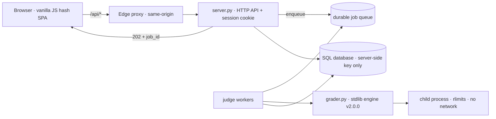

<div align="center">
  

  # Newbiegrader

  **An online judge for Thai competitive-programming instruction.**

  Async judging under real limits · undisclosed tests · contests · teacher tooling

  [](https://github.com/n3wbiekkkk/Newbiegrader/actions/workflows/ci.yml)
  
  
  
  
  

  ### [Try the live demo](https://newbiegrader.pages.dev)

  [Report a bug](../../issues) · [Adding a problem](#-adding-a-problem) · [Deploying](#-deploy)
</div>

---

Submit **Python / C / C++** and get judged automatically: `POST /api/submit` returns `202 + job_id`,
workers drain a durable queue under wall-clock timeouts and measured peak memory, and hidden
input / expected output / diffs never leave the server. Reloads, navigation and restarts lose nothing —
just poll and pick the run back up.

## Stack

<p>
  
  
  
  
  
  
</p>



| Layer | What lives there |
|---|---|
| `grader.py` | Standalone judging engine, Python standard library only |
| `server.py` | HTTP API, durable queue, per-account quotas, test-reveal policy |
| `static/` | Plain HTML/CSS/JS — **no build step** |
| `problems/<id>/` | `config.json` + `statement.pdf/md` + `tests/*.in\|*.out` (numeric `no` = easy → hard order) |
| `examples/<id>_ref.py` | Reference solutions — the source of truth for test generation |
| `supabase/schema.sql` | Schema plus append-only, re-runnable migrations |

## Quickstart

```bash
pip3 install -r requirements.txt
python3 server.py                 # http://127.0.0.1:8000 serves both API and frontend
```

No account or database needed to browse problems or use the CLI. A hosted SQL database (apply
`supabase/schema.sql` in its SQL editor) only unlocks history, statistics, leaderboards and contests.

```bash
python3 grader.py list
python3 grader.py run warpz examples/warpz_ref.py
```

## Verifying a change

```bash
python3 -m compileall -q grader.py server.py tools tests
node --check static/app.js && node tools/check_frontend.js && node tools/check_styles.js
python3 tools/validate_problem.py          # 55 problems: config, tests, samples, reference AC
python3 -m unittest discover -s tests -v   # no live server or database needed
```

CI runs the same sequence on every push and pull request to `main`.

## Adding a problem

1. Drop the statement as `problems/<id>/statement.pdf` (`id` is lowercase snake_case)
2. Write a Thai `statement.md`: story + `## Input` + `## Output` + `## ตัวอย่าง` (fenced `input:`/`output:` blocks) + `## Limits` — no hints or solutions
3. Typeset with `python3 tools/make_statement_tex.py <id>` and visually check every page
4. Fill in `config.json`, add 10+ tests (`tests/NN.in|NN.out`: statement samples byte-identical + edges + seeded randoms + max constraints), and `examples/<id>_ref.py`
5. Number it with `python3 tools/number_problems.py --assign` (numbers run easy → hard, unique)
6. `python3 grader.py run <id> examples/<id>_ref.py` must fully `ACCEPTED`, a wrong solution must fail, and `python3 tools/validate_problem.py <id>` must report 0 FAIL

## Deploy

- **Backend:** `git push <backend-remote> HEAD:deploy` (Docker: Python 3.11 + gcc/g++)
- **Frontend:** push `main` — Pages publishes `static/` automatically; `/api/*` goes through the same-origin proxy so the login cookie stays first-party
- Bump the `?v=N` stamp in `static/index.html` every time a versioned asset changes

## Contributing

Two invariants are non-negotiable:

1. **One judge only** — everything judges through `grader.run_one` / `grader.judge_test` / `grader.prepare_command`, never inside a request handler.
2. **Never disclose test data** — anything carrying test data passes through `_redact_results()`, on the response path and on the path to the database.

To join the Team table, open a pull request.

| Role | Person | Scope |
|---|---|---|
| Maintainer | [@n3wbiekkkk](https://github.com/n3wbiekkkk) | Judging engine, HTTP API, frontend, problem set, deployment |
| Contributors | [@Piyaph4t](https://github.com/Piyaph4t) | Judge-worker split (`judge_runner.py`/`worker.py`), queue test coverage |

Report security issues through the maintainer's profile, not a public issue.

## License

Copyright (C) 2026 Newbiegrader contributors — **GNU Affero General Public License, version 3 or later**
(full text in [`LICENSE`](LICENSE)).

**Network use (AGPL §13):** running a modified version for users over a network requires offering them
the Corresponding Source — for this deployment, <https://github.com/n3wbiekkkk/Newbiegrader>, linked
from every page footer.

The statement-PDF typeface is bundled under SIL OFL 1.1 (`tools/fonts/OFL.txt`); two web typefaces load
at runtime from a public CDN under the same licence. Dependencies are pinned in `requirements.txt` and
not vendored. No warranty; no trademark rights granted.
