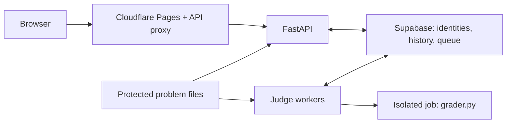

<div align="center">


# Newbiegrader

**Read a problem in Thai. Write a solution. Learn from the result.**

100 problems · 5 levels · Python 3 · C11 · C++17

[](https://github.com/n3wbiekkkk/Newbiegrader/actions/workflows/ci.yml)
[](grader.py)
[](CONTRIBUTING.md#development-setup)
[](LICENSE)

[**Start practicing**](https://newbiegrader.pages.dev) · [FAQ](https://newbiegrader.pages.dev/faq.html) · [Documentation](docs/README.md) · [Contribute](CONTRIBUTING.md)

</div>

Newbiegrader is an online judge for learning and practicing competitive
programming in Thai. It combines a problem catalog, a code editor, automatic
judging, submission review and timed contests in one lightweight web app.

The hosted catalog contains **100 problems and 1,814 test cases**, progressing
from basic implementation to data structures, graphs and dynamic programming.
The interface, statements and feedback are in Thai.

| What brings you here? | Start here |
| --- | --- |
| I want to solve problems | [Use the website](#start-practicing). No local installation is needed. |
| I want to work on the app | [Run locally](#run-locally), then follow [CONTRIBUTING.md](CONTRIBUTING.md). |
| I want to write a problem or solution | Follow the [problem](docs/making-problems.md) or [solution](docs/making-solutions.md) authoring guide. |
| I want to operate my own deployment | Read the [architecture](docs/PRODUCTION_ARCHITECTURE.md), [deployment](docs/HOST_DEPLOYMENT.md) and [release](docs/release/README.md) guides. |

## A look inside

| Desktop | Mobile · dark theme |
| --- | --- |
|  |  |

An eligible completed submission, viewed by another signed-in learner. This
view includes source code and measurements; private test input and diagnostics
are withheld.

## Start practicing

1. Open [Newbiegrader](https://newbiegrader.pages.dev) and sign in with email or
   Google. Email registration and password recovery use a verification code.
2. Choose a problem by level or topic. Search by title, ID or number, and combine
   difficulty, topic and progress filters.
3. Read the statement and examples, then write or upload Python, C or C++ code.
   Use a trial run to try your own input before making a scored submission.
4. Submit, follow the queue status, and review your verdict, time, memory and
   permitted feedback. Return to your history to compare attempts.

You can also:

- **Study solutions.** Available solution PDFs explain the approach, correctness
  and complexity, with C++17 and Python implementations. You do not have to solve
  the problem first; contest access restrictions still apply.
- **Learn from peers.** Inspect eligible completed submissions, subject to the
  current problem visibility and contest rules.
- **Join contests.** Register for timed rounds with announcements and frozen
  scoreboards. Contest results stay separate from practice statistics.
- **Make it your workspace.** Set your display name and default language, choose
  light or dark mode, recover your password, or delete your account in Settings.
  The layout supports desktop and mobile; Ctrl/Command + K opens problem search.

### Understanding results

| Verdict | Meaning |
| :---: | --- |
| `AC` | Accepted: every test passed. |
| `WA` | Wrong answer. |
| `TLE` | Time limit exceeded. |
| `MLE` | Memory limit exceeded. |
| `OLE` | Output limit exceeded. |
| `RE` | Runtime error. |
| `CE` | Compilation error. |

Time and memory are enforced and reported per test. A trial run uses your input
and does not add a scored submission to your history.

### What other people can see

**Your eligible completed source can be read by other signed-in members.**
Private test I/O, email and compiler/runtime diagnostics are excluded from the
peer view. Public submission lists contain neither source nor per-test results.

Practice owners can see bounded I/O and diagnostics for failed cases; accepted
private cases expose measurements only. Contest submissions and problems in
upcoming or running contests have stricter feedback and source-access rules.
Statements, samples, PDFs, solutions and member pages require login; the landing
page, public policies and authentication pages are available to guests.

See the [feedback policy](docs/submission-feedback-policy.md) for the full rules,
and the [privacy policy](https://newbiegrader.pages.dev/privacy.html),
[terms](https://newbiegrader.pages.dev/terms.html) and
[account-data guide](docs/ACCOUNT_DATA.md) for data handling and deletion.

## Run locally

The frontend uses vanilla HTML, CSS and JavaScript with **no build step**.
The application uses **Python 3.13** and FastAPI; Node.js runs the frontend
checks, and GCC/G++ are needed to judge C and C++.

> The public repository contains the application and tooling, **not the hosted
> problem catalog**. Authoring packages, private tests, reference solutions and
> editable solution sources are excluded from Git. A fresh clone does not give
> you a working copy of the hosted judge.

Clone the repository:

```sh
git clone https://github.com/n3wbiekkkk/Newbiegrader.git
cd Newbiegrader
```

### Preview the frontend

For layout and static-page work, serve `static/` on loopback:

```sh
python3 -m http.server 8080 --bind 127.0.0.1 --directory static
```

Open [localhost:8080](http://127.0.0.1:8080). This serves the frontend files only;
it does not provide the API proxy, login, problem data or judging.

### Run the application

```sh
python3.13 -m venv .venv
. .venv/bin/activate
python -m pip install -r requirements.txt
cp .env.example .env
```

Edit `.env` with your own development configuration before starting. For local
URLs, use:

```dotenv
FRONTEND_URL=http://127.0.0.1:8000
GRADER_CORS_ORIGINS=http://127.0.0.1:8000
SESSION_SECURE=false
```

Configure a private `SESSION_SECRET` and your development database/authentication
settings using [.env.example](.env.example), the
[email setup guide](docs/EMAIL_VERIFICATION_SETUP.md) and
[session guide](docs/SESSION_REVOCATION.md). If using Google login, configure its
local callback in both the provider and `GOOGLE_REDIRECT_URI`.

```sh
python server.py
```

Open [localhost:8000](http://127.0.0.1:8000). Database-backed account features need
a configured Supabase project and the applicable schema. To judge code, create
or obtain authorized local problem packages and configure their storage through
the [authoring guide](docs/making-problems.md) and
[metadata/file-storage guide](docs/migration-supabase.md). Maintainers can use the
[private package synchronization workflow](docs/making-solutions.md#sync-private-authoring-packages-between-development-machines).

The standalone engine in `grader.py` uses only the Python standard library.
Run `python3 grader.py --help` to inspect its CLI. It still needs a local problem
package to judge a solution.

## System design



A submission moves through three stages:

1. **Admission:** the API checks identity, quotas and queue bounds, then returns
   `202` and a job ID.
2. **Execution:** a worker claims the job, compiles when needed and runs the
   tests. The browser polls while the job is queued or running.
3. **Completion:** the current disclosure policy is applied before results are
   stored and returned. Durable completion commits the result and history
   together.

The same standard-library engine judges CLI, trial-run and submission paths.
Production separates API and worker roles; the executor carries no database
credentials. Its qualified Linux runtime uses per-job identities, cgroups,
Landlock, seccomp, bounded workspaces and descendant cleanup.

**Local queue mode is single-process and best-effort.** It does not guarantee
recovery after a restart or database outage. Coordinated workers use the database
queue with leases and crash recovery. Other platforms provide reduced local
execution controls; they do not establish the Linux isolation guarantees.

| Code | Responsibility |
| --- | --- |
| `static/`, `functions/` | Browser interface and same-origin API proxy. |
| `server.py`, `email_auth.py` | API, identity, admission and visibility policy. |
| `submission_disclosure.py` | Submission disclosure, audience projections and stored feedback. |
| `account_deletion.py` | Resuming prepared account deletion for web requests and scheduled recovery. |
| `judge_lifecycle.py` | Owned judging attempts, heartbeat supervision and fenced completion. |
| `problem_catalog.py` | Catalog snapshots, numeric lookup and coordinated version refresh. |
| `grader.py`, `judge_execution.py`, `judge_runner.py` | Judging engine and supervised execution. |
| `worker.py`, `database_client.py` | Dedicated workers and queue transport. |
| `job_sandbox.py`, `job_resources.py` | Isolation, resource enforcement and cleanup. |
| `problem_store.py`, `backend_problem_files.py` | Metadata and protected file access. |
| `supabase/`, `tests/`, `tools/` | Schema, regression tests and authoring tools. |

Deployment topology and allocations live in the
[production architecture](docs/PRODUCTION_ARCHITECTURE.md); capacity and queue
behavior are covered in [load handling](docs/load-handling.md). A push to `main`
deploys Pages, while the backend follows its separate release procedure.
Qualification evidence and remaining limits are tracked in
[security readiness](docs/SECURITY_READINESS.md) and
[public security](docs/PUBLIC_SECURITY.md).

## Validation

From an environment with the development dependencies installed:

```sh
node --check static/app.js
node tools/check_frontend.js
node tools/check_styles.js
node --test tests/test_*.js
python -m unittest discover -s tests -v
python tools/validate_problem.py
python tools/plagiarism.py
```

The [CI workflow](.github/workflows/ci.yml) defines the complete checks, including
pinned dependency audits, Linux critical canaries and real disposable PostgreSQL
checks for permissions, queues and sessions. A public clone has no private
catalog to validate. Report skipped checks and platform limits; passing frontend
or macOS tests does not qualify production isolation. See
[CONTRIBUTING.md](CONTRIBUTING.md#running-the-tests) for checks by change type.

## Contribute and get help

Start with [CONTRIBUTING.md](CONTRIBUTING.md) for setup and review expectations.
Bug reports, documentation improvements, code and problem proposals are welcome.
Authors should use the versioned workflows for
[problems](docs/making-problems.md) and [solutions](docs/making-solutions.md).

- **Usage questions:** read the [FAQ](https://newbiegrader.pages.dev/faq.html) or
  join [Discord](https://discord.gg/7NQDHFBpf6).
- **Reproducible bugs:** open a [GitHub issue](https://github.com/n3wbiekkkk/Newbiegrader/issues)
  with steps, expected behavior and the result you observed.
- **Account or security concerns:** contact
  [newbiegrader.team@gmail.com](mailto:newbiegrader.team@gmail.com). Follow
  [SECURITY.md](SECURITY.md) for vulnerability reports; do not post credentials or
  private submissions in public issues.
- **Operator and author references:** use the [documentation index](docs/README.md).

### Contributors

| Contributor | Work |
| --- | --- |
| [@n3wbiekkkk](https://github.com/n3wbiekkkk) · Maintainer | Judging engine, API, frontend, problem set and deployment. |
| [@Piyaph4t](https://github.com/Piyaph4t) | Judge-worker separation and queue regression coverage. |
| [@pxsit](https://github.com/pxsit) | Python 3.13 runtime upgrade and upgrade documentation. |

See the [full contributor history](https://github.com/n3wbiekkkk/Newbiegrader/graphs/contributors).

## License

Copyright (C) 2026 Newbiegrader contributors. Source code: <https://github.com/n3wbiekkkk/Newbiegrader>.

### Code

This program is free software, released under the **GNU Affero General Public License v3.0 or later** (`AGPL-3.0-or-later`). The full license text is in [LICENSE](LICENSE).

Under AGPL §13, running a modified version for users over a network requires offering them the Corresponding Source. For this deployment, the source is available at <https://github.com/n3wbiekkkk/Newbiegrader>.

### Name and logo

The Newbiegrader name and logo are **not** covered by the code license. All rights reserved.

### Third-party typefaces

Statement PDFs embed typefaces that keep their own licenses and are not covered by the licenses above: Anuphan and Inconsolata under SIL OFL 1.1, Latin Modern Roman under the GUST Font License, and TH Sarabun New under GPL-2.0-or-later with the font-embedding exception (so the rendered PDFs are not covered by the GPL). See `tools/fonts/`.

No warranty is provided and no trademark rights are granted.
