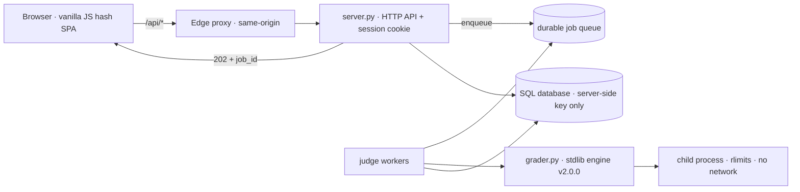

<div align="center">
  

  # Newbiegrader

  **An online judge for Thai competitive-programming instruction.**

  Strict limits, undisclosed tests, asynchronous judging, contests, and teacher tooling.

  [](https://github.com/n3wbiekkkk/Newbiegrader/actions/workflows/ci.yml)
  
  
  

  ### [Try the live demo](https://newbiegrader.pages.dev)

  [Report a bug](../../issues) · [Adding a problem](#7-adding-a-problem) · [Deployment](#9-deployment)
</div>

---

## 1. Overview

Newbiegrader is a web-based programming judge designed for teaching competitive
programming in Thai. Students submit solutions in **Python 3, C (C11), or
C++ (C++17)** and receive automatic verdicts under real time and memory limits.
The test data behind each problem — inputs, expected outputs, and diffs — is
never disclosed: only the public sample tests from the problem statement are
ever shown.

The system currently ships **62 problem packages with 908 test cases**,
each with a reference solution, and a judging engine versioned as
`grader v2.0.0` so that every recorded verdict can be traced to the exact test
set and engine that produced it.

Two invariants are non-negotiable throughout the codebase:

1. **A single judging engine.** All verdicts flow through
   `grader.run_one` / `grader.judge_test` / `grader.prepare_command`.
   No judging logic is duplicated in request handlers.
2. **No test-data disclosure.** Every payload carrying test data passes
   through result redaction before it is returned to a client and before it
   is persisted.

## 2. Key features

- **Honest limits.** Wall-clock timeouts, measured peak memory, and process
  isolation (`rlimits`, privilege drop, network namespace where available).
  Verdicts distinguish `AC`, `WA`, `TLE`, `MLE`, `OLE` (output limit),
  `RE`, and `CE`, with per-test timing and memory figures.
- **Asynchronous judging.** `POST /api/submit` returns `202 Accepted` with a
  `job_id` immediately; workers drain a durable queue and the client polls
  `GET /api/jobs/{id}`. Reloads, navigation, and server restarts do not lose
  submissions.
- **Undisclosed tests.** Hidden tests return only the verdict and resource
  figures. Sample inputs, expected outputs, and diffs are served solely for
  tests declared public in the problem configuration.
- **Contests.** Timed Codeforces-style rounds with registration, frozen
  scoreboards, organizer announcements, and contest-only problems that stay
  out of the public task list. Contest scores never leak into the global
  leaderboard.
- **Teacher tooling.** Submission history, per-problem statistics, plagiarism
  screening, one-click rejudging, problem reporting, and an admin overview
  with queue monitoring.
- **No frontend build step.** The interface is plain HTML, CSS, and
  JavaScript served as static files.

## 3. Architecture



| Layer | Responsibility |
|---|---|
| `grader.py` | Standalone judging engine using only the Python standard library: problem loading, compilation, sandboxed execution, checkers, and the command-line interface. |
| `server.py` | FastAPI application: authentication, the asynchronous job queue, quota and visibility policy, result redaction, and static-file serving. |
| `judge_runner.py` / `worker.py` | Supervised bounded execution and the dedicated worker role (HTTP-less judging). |
| `static/` | The web interface. No bundler, no transpiler, no framework. |
| `functions/api/[[proxy]].js` | Cloudflare Pages function proxying `/api/*` to the backend so the login cookie remains first-party. |
| `problems/<id>/` | One directory per problem: `config.json`, statement, and paired `tests/NN.in` / `NN.out` fixtures. |
| `examples/<id>_ref.py` | Reference solutions — the source of truth for test generation. |
| `supabase/schema.sql` | The complete database schema with append-only, re-runnable migrations. |

Host capacity (CPU quota, available RAM) is read from the container's cgroup
at startup, and worker counts, memory ceilings, queue bounds, and timeouts are
derived from it automatically.

## 4. Quickstart

Requirements: Python 3.11, a C/C++ toolchain for compiled languages, and
Node.js for the frontend checks.

```bash
pip install -r requirements.txt
python server.py                         # serves UI + API at http://127.0.0.1:8000
```

No account or database is required to browse problems or judge from the
command line. A hosted SQL database (apply `supabase/schema.sql` in its SQL
editor) additionally unlocks history, statistics, leaderboards, and contests.

```bash
python grader.py list
python grader.py run <problem_id> <solution_file>
```

## 5. Judging semantics

- Each submission is compiled (when applicable) and executed once per test
  case inside a supervised child process with address-space, CPU-time,
  process-count, file-size, and open-file limits.
- Output beyond 32 MB is truncated and scored as `OLE`. Infinite loops are
  stopped by the wall-clock limit and scored as `TLE`; exceeding the memory
  threshold is scored as `MLE`.
- Output checkers: `token` (whitespace-insensitive, the default), `exact`
  (byte-precise per line), `float` (absolute/relative tolerance), and
  `decimal2` (two-decimal-place comparison).
- Small-numbered tests (`01`, `02`, …) are the public statement samples;
  tests numbered from `1001` upward are hidden. A submission is accepted only
  when every test passes.
- Declared limits that exceed what the host can safely provide are clamped,
  and the response reports both the declared and the enforced values.

## 6. Web API

All endpoints live under `/api`. Authentication uses an `HttpOnly`
`SameSite=lax` session cookie (Google OAuth or password accounts).

| Area | Endpoints |
|---|---|
| Problems | `GET /api/problems`, `/api/problems/{id}`, `/sample/{name}`, `/pdf`, `/api/languages`, `/api/version`, `/api/health` |
| Judging | `POST /api/submit` → `202 + job_id`, `GET /api/jobs/{id}`, `POST /api/run` (unrecorded playground) |
| History | `GET /api/history`, `GET /api/history/{id}` (owner or admin; source code included) |
| Contests | `GET/POST /api/contests`, `/api/contests/{id}`, `/register`, announcements |
| Rankings | `GET /api/leaderboard`, `GET /api/stats` |
| Administration | `/api/admin/overview`, `/rejudge`, `/plagiarism`, reports |
| Accounts | Google OAuth, password register/login, `GET/PUT /api/profile` |

Problem identifiers accept either the slug (`hanoi`) or the permanent problem
number (`19`). Responses carrying test data are redacted according to the
caller's role: administrators see everything, regular users see public samples
only, and live contests configured to hide samples reveal nothing.

## 7. Adding a problem

1. Place the statement as `problems/<id>/statement.pdf`, where `<id>` is
   lowercase `snake_case`.
2. Write a Thai `statement.md` containing the story, `## Input`,
   `## Output`, `## ตัวอย่าง` (fenced `input:`/`output:` blocks), and
   `## Limits`. Solution hints do not belong in statements.
3. Add `config.json` (title, `time_limit`, `memory_limit`, `checker`,
   `difficulty`, `tags`, `samples`, and the permanent problem number `no`).
4. Add at least 10 tests as `tests/NN.in` / `NN.out` pairs: statement samples
   reproduced byte-identically, edge cases, boundary values, seeded random
   cases, maximum-constraint cases, and traps for common incorrect approaches.
5. Provide `examples/<id>_ref.py`, a reference solution that must be fully
   accepted, and confirm that representative incorrect solutions fail.
6. Assign the problem number with `python tools/number_problems.py --assign`.
7. Validate with the commands in [Verification](#8-verification).

Problems used exclusively in contests set `"hidden": true` in `config.json`
so they stay out of the public task list while remaining reachable from their
contest page and the admin panel.

## 8. Verification

Run from the repository root before every commit:

```bash
python -m compileall -q grader.py server.py tools tests
node --check static/app.js && node tools/check_frontend.js && node tools/check_styles.js
python tools/validate_problem.py          # every package: config, tests, samples, reference verdict
python -m unittest discover -s tests -v   # API, queue, and sandbox suites (no live server or database needed)
```

Continuous integration executes the same sequence on every push and pull
request to `main`. The server must be restarted after problem changes, since
problems are loaded at boot.

## 9. Deployment

- **Backend.** A Docker image (Python 3.11 plus GCC/G++) is built from a git
  push to the backend remote; the container serves the API and runs the
  judge workers. Separated `api` and `worker` roles with a database-backed
  queue are supported for larger installations.
- **Frontend.** Pushing `main` publishes `static/` to Cloudflare Pages
  automatically; `/api/*` is proxied to the backend on the same origin.
- Bump the `?v=N` asset stamp in `static/index.html` whenever a versioned
  JavaScript, CSS, or image file changes.
- Database changes are appended to `supabase/schema.sql` as idempotent
  migrations and applied by the maintainer through the Supabase SQL editor.

## 10. Configuration

Local development reads an untracked `.env` file (see `.env.example` for the
full template). Production uses host environment variables. Secrets — in
particular the Supabase service-role key — remain server-side at all times
and are never exposed to the browser or committed to the repository.

## 11. Contributing

Contributions are welcome via pull requests. Please explain the change, link
any related issues, report the [verification](#8-verification) results, and
include screenshots for user-interface changes. History follows short
descriptive subjects, optionally prefixed by area (for example,
`Frontend: refresh problem visibility`).

To join the team table, open a pull request.

| Role | Person | Scope |
|---|---|---|
| Maintainer | [@n3wbiekkkk](https://github.com/n3wbiekkkk) | Judging engine, HTTP API, frontend, problem set, deployment |
| Contributors | [@Piyaph4t](https://github.com/Piyaph4t) | Judge-worker split (`judge_runner.py`/`worker.py`), queue test coverage |

Please report security issues through the maintainer's profile rather than a
public issue.

## 12. License

Copyright (C) 2026 Newbiegrader contributors — **GNU Affero General Public
License, version 3 or later** (full text in [`LICENSE`](LICENSE)).

**Network use (AGPL §13):** running a modified version for users over a
network requires offering them the Corresponding Source — for this
deployment, <https://github.com/n3wbiekkkk/Newbiegrader>, linked from every
page footer.

The statement-PDF typeface is bundled under SIL OFL 1.1 (`tools/fonts/OFL.txt`).
Dependencies are pinned in `requirements.txt` and are not vendored. No
warranty is provided and no trademark rights are granted.
