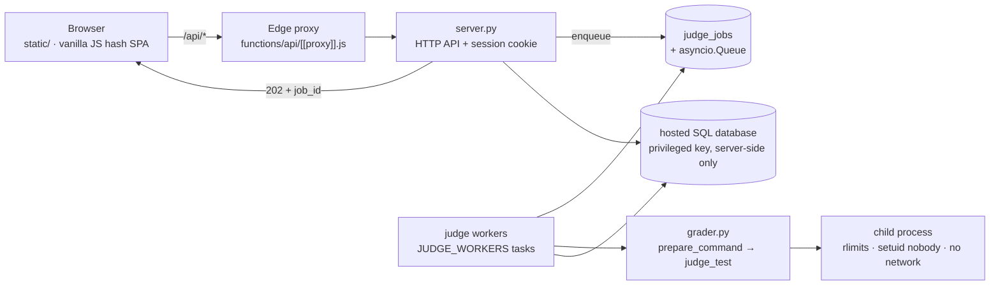

# Newbiegrader

**An online judge for Thai competitive-programming instruction.**

[](https://github.com/sphetpitak-sudo/gradernew/actions/workflows/ci.yml)


Newbiegrader runs submitted code under enforced time and memory limits, judges it against a test set
that is not disclosed to students, and operates as a complete web service with contests, submission
history, plagiarism analysis and administrative tooling.

## What it provides

- **Real limits, not estimates.** Wall-clock timeout plus `RLIMIT_CPU`; `RLIMIT_AS`/`RLIMIT_DATA` per
  test, with the measured peak memory deciding the verdict. Interpreted runtimes get a documented
  memory allowance (×2.5, more for stack-based runtimes) so students are judged on their algorithm
  rather than on their runtime's per-value overhead, while compiled languages are held to the declared
  limit. Verdicts: `AC`, `WA`, `TLE`, `MLE`, `OLE`, `RE`, `CE`.
- **Undisclosed tests.** Only the samples declared in `config.json` are shown; ten to eighteen hidden
  tests per problem decide the score. Hidden input, expected output and diffs never leave the server.
- **Asynchronous judging.** `POST /api/submit` returns `202` with a job id; workers drain a durable
  queue. A reload, a navigation or a restart does not lose a run or its verdict.
- **Contests, history, leaderboards.** Timed rounds with registration, a score freeze for
  non-administrators, and contest points isolated from the permanent ranking; per-problem statistics;
  winnowing similarity detection over submitted code.
- **A frontend that keeps the student's work.** Drafts autosaved per problem, Tab/Shift+Tab indentation,
  `Cmd/Ctrl+Enter` to submit, verdicts and dates in Thai, WCAG AA contrast in both themes.

## Stack

A small ASGI web framework and server on the back end (pinned in `requirements.txt`); a dependency-free
Python standard-library judging engine (`grader.py`); a vanilla HTML/CSS/JS frontend with **no build
step**; an optional hosted SQL database for history, statistics and contests; judging in disposable
child processes under `rlimit` isolation.



## Getting started

```bash
pip3 install -r requirements.txt
python3 server.py                 # http://127.0.0.1:8000, serves the API and static/
```

Browsing problems and using the CLI need neither an account nor a database. A hosted SQL database —
apply the schema script shipped in the repository — is required only for history, statistics,
leaderboards and contests.

The judge also runs standalone:

```bash
python3 grader.py list
python3 grader.py run warpz examples/warpz_ref.py
python3 grader.py run mana_crystal examples/mana_crystal_ref.py --strict --stop-on-fail
```

## Verifying a change

```bash
python3 -m compileall -q grader.py server.py tools tests
node --check static/app.js && node tools/check_frontend.js && node tools/check_styles.js
python3 tools/validate_problem.py          # 47 problems: config, tests, samples, reference AC
python3 -m unittest discover -s tests -v   # 46 tests, no live server or database needed
```

The same sequence runs in continuous integration on every push and pull request to `main`.

## Deployment

Backend: build the container image defined in the repository (a Python 3.11 base with a C/C++
toolchain) and publish it to a container host — `git push <backend-remote> HEAD:deploy`. Frontend:
publish `static/` as-is; the bundled `functions/api/[[proxy]].js` proxies `/api/*` to the back end
under the same origin, so the session cookie stays first-party. Bump the `?v=N` stamp whenever a
versioned asset changes.

## Contributing

Two invariants are non-negotiable:

1. **One judge only.** All judging passes through `grader.run_one`, `grader.judge_test` and
   `grader.prepare_command`; never inline judging into a request handler.
2. **Never disclose test data.** Everything carrying test data passes through `_redact_results()`, both
   on the response path and on the path to the database.

A problem is a directory under `problems/`; `tools/validate_problem.py` is the gate — it checks the
configuration, the sample wiring, and requires every reference solution in `examples/` to be accepted
on every test. The operational manual (hosts, deployment, environment variables, the catalogue of
pitfalls) is maintained privately and is not part of this repository.

## License

Copyright (C) 2026 Newbiegrader contributors. This program is free software: you may redistribute it
and/or modify it under the terms of the **GNU Affero General Public License, version 3 or later**, as
published by the Free Software Foundation. The full text is in [`LICENSE`](LICENSE).

**Network use (AGPL section 13).** Operating a modified version and letting users interact with it over
a network requires offering those users the Corresponding Source of the running version. For this
deployment that source is <https://github.com/sphetpitak-sudo/gradernew>, linked from the footer of
every page; any other instance must make an equivalent offer.

**Bundled and linked third-party components.** The Thai typeface used to typeset statement PDFs is
bundled with the repository and is licensed under the SIL Open Font License 1.1; the licence text
ships beside the font files (`tools/fonts/OFL.txt`). Two web typefaces are loaded at runtime from a
public font CDN under the same licence and are not redistributed here. Language-level dependencies are
pinned in `requirements.txt` and are not vendored into this repository.

**Warranty.** Distributed in the hope that it will be useful, but without any warranty; without even
the implied warranty of merchantability or fitness for a particular purpose (licence sections 15–16).

**Trademarks.** The licence covers copyright only; it grants no rights in the project name, logo or
domains. Contributions are accepted on the understanding that they may be distributed under the same
licence.
