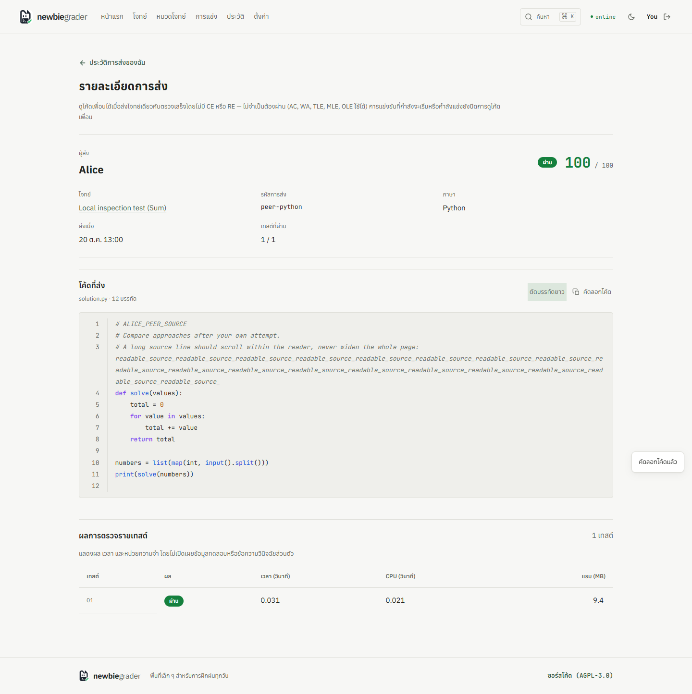
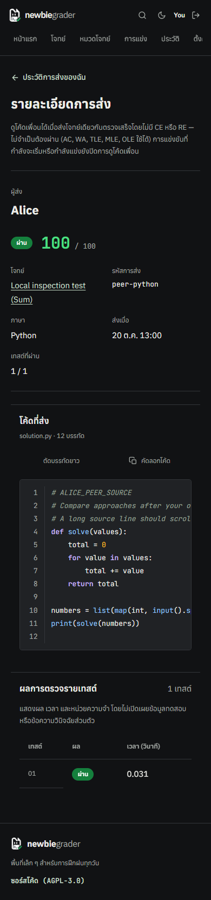

<div align="center">


# Newbiegrader

**An online judge for practicing competitive programming in Thai.**

Python 3 · C11 · C++17 · Automatic judging · Contests · Official solutions

[](https://github.com/n3wbiekkkk/Newbiegrader/actions/workflows/ci.yml)
[](LICENSE)


[Start Practicing](https://newbiegrader.pages.dev) · [Documentation](docs/README.md) · [Contributing](CONTRIBUTING.md) · [Report a Bug](https://github.com/n3wbiekkkk/Newbiegrader/issues) · [Discord](https://discord.gg/7NQDHFBpf6)

</div>

---

## Contents

- [About](#about)
- [Screenshots](#screenshots)
- [Features](#features)
- [How judging works](#how-judging-works)
- [Feedback and access](#feedback-and-access)
- [Verdicts](#verdicts)
- [Quick start](#quick-start)
- [Tests](#tests)
- [Architecture](#architecture)
- [Documentation](#documentation)
- [Contributing](#contributing)
- [Contributors](#contributors)
- [License](#license)

## About

Newbiegrader is an online judge for anyone who wants to practice competitive
programming in Thai. Choose a problem, write a solution in **Python 3**, **C11**
or **C++17**, and receive a verdict with execution time and memory measurements.

The catalog contains **100 problems and 1,814 test cases**, from basic
implementation and strings to graphs, data structures and dynamic programming.
Problems have five calibrated levels, grouped into easy, medium and hard.
Stable problem IDs preserve links and submission history; the
[catalog number map](docs/catalog/problem-numbers-2026-10-24.csv) records the
approved numbering.

Visit [Newbiegrader](https://newbiegrader.pages.dev) and create an account to
open the problem catalog, submit code, join contests and read official solutions.
The landing page and account registration/recovery are available to guests.
Statements, feedback and the interface are in Thai.

## Screenshots

| Desktop | Mobile, dark theme |
| --- | --- |
|  |  |

A signed-in member inspecting an eligible completed submission: verdict,
per-test measurements and source. Private test input and diagnostics are never
included in this view.

## Features

| Feature | What you can do |
| --- | --- |
| Thai problem statements | Read statements and PDFs, inspect public examples, and choose a problem by topic or level. |
| Multiple catalog filters | Select several topics and difficulty bands together, search by title/ID/number, sort results, and remove individual filters. Choices persist in the browser. |
| Shared code editor | Write code with line numbers and indentation shortcuts, attach a source file, and keep the same code when switching between submission and trial-run tabs. |
| Account settings | Edit your display name and default language, choose a theme, start password recovery, sign out of this device, or delete your account after email confirmation. |
| Trial runs | Run code against your own input without adding a scored submission to your history. |
| Asynchronous judging | Submit a solution and follow its queued/running state until the verdict is ready. |
| Official solution PDFs | Read the approach, correctness argument, complexity and complete **C++17 and Python 3** implementations. C++17 appears first. |
| Submission history | Review your results and inspect eligible completed submissions from other members, subject to visibility and contest rules. |
| Contests | Join timed rounds with registration, organizer announcements and frozen scoreboards. |
| Administration | Manage contests, inspect queue health, review problem reports, rejudge submissions and screen for code similarity. |
| Light and dark themes | Use the same interface on desktop and mobile, with keyboard navigation and a Ctrl/Command + K problem search. |

## How judging works

1. **Accept.** The API checks admission, account quotas and queue bounds, then
   returns `202` with a job ID.
2. **Execute.** A worker claims the job under a lease and compiles when needed.
   On the qualified Linux deployment, each test runs under the job's private
   identity, cgroup, resource limits and bounded workspace.
3. **Complete.** Results pass through the current practice/contest disclosure
   policy before storage and delivery. The browser polls while the job is queued
   or running, then displays the verdict and permitted details.

Every verdict comes from the same standard-library engine in `grader.py`;
request handlers never reimplement judging. Database queue mode coordinates
worker leases and commits completion and history together. Local queue mode is
single-process and best-effort; it does not guarantee recovery after a restart or
a database outage.

## Feedback and access

Problem statements, PDFs, samples, solutions and other member pages require
login. These checks are enforced by the API as well as the frontend.

- **Practice:** owners can inspect bounded input, expected output, actual output
  and diagnostics for failed cases. Accepted private cases expose measurements
  only.
- **Contests:** hidden test data stays private. Upcoming or running contests
  also restrict extra feedback through the practice path.
- **Solutions:** signed-in members can read available solutions without first
  solving the problem. Solutions for problems in upcoming or running contests
  are withheld until those contests end.
- **Peer submissions:** eligible completed submissions can be inspected by
  signed-in members without a prior attempt. Private test I/O and diagnostics
  are excluded, and current visibility/contest checks still apply.

See the [submission feedback policy](docs/submission-feedback-policy.md) and
[solution access rules](docs/making-solutions.md#member-access-and-protected-backend-files)
for the complete boundaries. Previously disclosed practice data must not be
reused as a secret contest suite.

Read the [privacy policy](https://newbiegrader.pages.dev/privacy.html),
[terms](https://newbiegrader.pages.dev/terms.html) and
[FAQ](https://newbiegrader.pages.dev/faq.html) before using the service. Account
export and deletion, retention periods and rollout limits are documented in the
[account-data guide](docs/ACCOUNT_DATA.md).

## Verdicts

| Verdict | Meaning |
| :---: | --- |
| `AC` | Accepted: every test passed. |
| `WA` | Wrong answer. |
| `TLE` | Time limit exceeded. |
| `MLE` | Memory limit exceeded. |
| `OLE` | Output limit exceeded. |
| `RE` | Runtime error. |
| `CE` | Compilation error. |

Time and memory are enforced and reported per test. Memory accounting keeps the
difference between measured usage and the address-space safety limit, so a
declared memory limit is not a raw address-space cap.

## Quick start

Use **Python 3.13**, **Node.js**, and **GCC/G++**. The frontend is plain HTML,
CSS and JavaScript; it has no bundler or build step.

```sh
git clone https://github.com/n3wbiekkkk/Newbiegrader.git
cd Newbiegrader
python3.13 -m venv .venv
. .venv/bin/activate
python -m pip install -r requirements.txt
cp .env.example .env
```

Configure your own development environment in `.env`, then start the server:

```sh
python server.py
```

Open [localhost:8000](http://127.0.0.1:8000). Account and database features need
a configured development Supabase project; see the
[metadata and file-storage guide](docs/migration-supabase.md) and
[email setup](docs/EMAIL_VERIFICATION_SETUP.md). Keep credentials server-side
and use a separate development environment for experiments.

**A public clone does not contain the problem packages.** Statements, private
tests, reference solutions and editable solution sources are excluded from Git.
Maintainers transfer authoring packages separately through the
[private synchronization workflow](docs/making-solutions.md#sync-private-authoring-packages-between-development-machines).
A server starting successfully does not establish that judging is configured.
For a frontend-only preview, serve `static/` locally; authentication and judging
still require the configured backend.

## Tests

```sh
# Frontend
node --check static/app.js
node tools/check_frontend.js
node tools/check_styles.js
node --test tests/test_*.js

# Python, API and problem tooling
python -m unittest discover -s tests -v
python tools/validate_problem.py
python tools/plagiarism.py
```

The [CI workflow](.github/workflows/ci.yml) defines the complete checks, including
Linux isolation and disposable PostgreSQL qualification. A frontend check, a
passing macOS run or an empty problem directory does not qualify a judge
deployment; sandbox changes require the Linux critical suite to pass with no
skips.

## Architecture

| Component | Responsibility |
| --- | --- |
| `static/` | Vanilla frontend, served through Cloudflare Pages in production. |
| `functions/api/[[proxy]].js` | Same-origin edge API proxy. |
| `server.py` | FastAPI: identity, admission, visibility, feedback policy and API responses. |
| `grader.py` | Shared standard-library judging engine, checkers and language limits. |
| `judge_execution.py`, `judge_runner.py`, `worker.py` | Supervised jobs and dedicated judge workers. |
| `job_sandbox.py`, `job_resources.py` | Linux isolation, resource enforcement and descendant cleanup. |
| `problem_store.py`, `backend_problem_files.py` | Protected problem metadata and backend file storage. |
| `supabase/` | Metadata, identities, history and durable queue schema. |
| `tools/`, `tests/` | Authoring, publication, validation and regression checks. |

Production uses separate API and worker roles. The executor remains
credential-free, with per-job identities, cgroups, Landlock, seccomp and bounded
workspaces, and private problem files are served only through authenticated
backend endpoints. Private fixtures, references and author archives are excluded
from static hosting.

Isolation is implemented for Linux; other platforms start in a reduced
rlimits-only development mode. Release and qualification evidence, including its
scope and date, is recorded under [`docs/releases/`](docs/releases/).

## Documentation

The [documentation index](docs/README.md) is the entry point for operators and
authors. Frequently used guides:

| Topic | Guide |
| --- | --- |
| Authoring, sample synchronization and PDFs | [Making problems](docs/making-problems.md) |
| Solution authoring and member access | [Making solutions](docs/making-solutions.md) |
| Practice, contest and peer feedback boundaries | [Submission feedback](docs/submission-feedback-policy.md) |
| Protected problem roots, hashes and publication | [Backend problem files](docs/BACKEND_PROBLEM_FILES.md) |
| Topology, services and allocations | [Production architecture](docs/PRODUCTION_ARCHITECTURE.md) |
| Queue bounds, scheduling and load testing | [Load handling](docs/load-handling.md) |
| Sandbox scope and accepted limitations | [Security readiness](docs/SECURITY_READINESS.md), [public security](docs/PUBLIC_SECURITY.md) |
| Website sessions and recovery | [Session revocation](docs/SESSION_REVOCATION.md) |

## Contributing

Bug reports, problem proposals and pull requests are welcome. See
[CONTRIBUTING.md](CONTRIBUTING.md) for the setup, validation and review workflow.
Describe the behavior you are changing and the checks you ran. Report suspected
vulnerabilities privately using [SECURITY.md](SECURITY.md).

- **Problems:** use the [problem authoring workflow](docs/making-problems.md)
  and versioned templates in `tools/templates/problem/`.
- **Solutions:** use the [solution authoring workflow](docs/making-solutions.md)
  and `tools/solution_authoring.py`; qualify both C++17 and Python against the
  shipped cases before publication.
- **Frontend:** keep the vanilla stack, support both themes, and verify desktop
  and mobile behavior. Include screenshots for visual changes.
- **Backend:** preserve asynchronous judging, authorization, disclosure and
  sandbox boundaries. Add regression coverage for behavior changes.

Keep private packages, credentials, local configuration and operator archives
out of pull requests.

## Contributors

| Role | Contributor | Contributions |
| --- | --- | --- |
| Maintainer | [@n3wbiekkkk](https://github.com/n3wbiekkkk) | Judging engine, API, frontend, problem set and deployment. |
| Contributor | [@Piyaph4t](https://github.com/Piyaph4t) | Judge-worker separation and queue regression coverage. |
| Contributor | [@pxsit](https://github.com/pxsit) | Python 3.13 runtime upgrade and upgrade documentation. |

See the [full contributor history](https://github.com/n3wbiekkkk/Newbiegrader/graphs/contributors)
on GitHub.

## License

Copyright (C) 2026 Newbiegrader contributors. Source code: <https://github.com/n3wbiekkkk/Newbiegrader>.

### Code

This program is free software, released under the **GNU Affero General Public License v3.0 or later** (`AGPL-3.0-or-later`). The full license text is in [LICENSE](LICENSE).

Under AGPL §13, running a modified version for users over a network requires offering them the Corresponding Source. For this deployment, the source is available at <https://github.com/n3wbiekkkk/Newbiegrader>.

### Name and logo

The Newbiegrader name and logo are **not** covered by the code license. All rights reserved.

### Third-party typefaces

Statement PDFs embed typefaces that keep their own licenses and are not covered by the licenses above: Anuphan and Inconsolata under SIL OFL 1.1, Latin Modern Roman under the GUST Font License, and TH Sarabun New under GPL-2.0-or-later with the font-embedding exception (so the rendered PDFs are not covered by the GPL). See `tools/fonts/`.

No warranty is provided and no trademark rights are granted.
