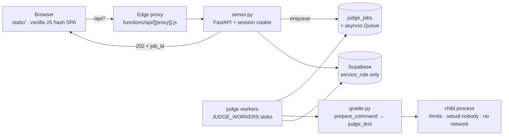

# Newbiegrader

**An online judge for Thai competitive-programming instruction.**

[](https://github.com/sphetpitak-sudo/gradernew/actions/workflows/ci.yml)


Newbiegrader executes submitted source code under enforced wall-clock and memory limits, evaluates it
against a test set that is not disclosed to students, and operates as a complete web service with
contest management, submission history, plagiarism analysis and administrative tooling.

The frontend consists of four manually authored static files and requires no build step, no bundler and
no framework. The judging engine (`grader.py`) depends only on the Python standard library. Server-side
dependencies are confined to FastAPI, Uvicorn, `python-multipart`, `itsdangerous` and the Supabase
client.



---

## 1. Enforcement model

| Mechanism | Implementation |
|---|---|
| **Time limit** | Wall-clock timeout applied to the child process, in addition to `RLIMIT_CPU`, so that a non-yielding infinite loop is terminated regardless of scheduler behaviour. |
| **Memory limit** | `RLIMIT_AS` / `RLIMIT_DATA` per test case. Peak resident set size is sampled during execution (`GRADER_SAMPLE_INTERVAL`) and reported to the student. |
| **Undisclosed tests** | Only the samples declared in `config.json` are disclosed. Between ten and eighteen tests per problem determine the score; the remainder are described to the student by verdict and timing alone. |
| **Output comparison** | A unified diff in which spaces are rendered as `·` and tabs as `→`, so that whitespace-only differences are visible. The `--strict` mode of the CLI performs byte-exact comparison. |
| **Output bounds** | `OLE` for unbounded output, `RLIMIT_FSIZE` (64 MB) for file writes, `RLIMIT_NPROC` (64) for process creation. |
| **Isolation** | The judged process is executed as `nobody` without network access, and `problems/` is shipped with permissions that prevent the child from reading expected outputs (see §5). |

Verdict codes: `AC` accepted · `WA` wrong answer · `TLE` time limit exceeded · `MLE` memory limit
exceeded · `OLE` output limit exceeded · `RE` runtime error · `CE` compilation error.

Scoring is OI-style: `100 × passed / total`, with full marks awarded only when every test case passes.

---

## 2. Submission lifecycle

Judging is asynchronous. An HTTP request never performs judging work in the request handler.

1. `POST /api/submit` (multipart) authenticates the caller, verifies that the problem is visible to
   them and that any contest window permits submission, applies the per-account quota, inserts a
   `judge_jobs` row, and responds immediately with **`202` and a `job_id`**.
2. A pool of `JUDGE_WORKERS` asyncio tasks consumes the queue and executes each job in a worker thread
   under an overall deadline.
3. `grader.prepare_command()` compiles the submission only when a compilation step is required
   (`g++ -O2 -std=c++17 -Wall -Wextra`, `gcc -O2 -std=c11 -Wall -Wextra`, or the corresponding
   Java/Go/Rust toolchain in CLI use). `grader.judge_test()` then executes each test case with the
   resource limits applied.
4. Results are reduced to the caller's disclosure level, persisted, and returned when the client polls
   `GET /api/jobs/{id}` (approximately every 700 ms).

Job status is one of `queued`, `running`, `done` or `error`. Failures are reported explicitly: `401`
not authenticated, `409` a job is already in flight for the account, `429` quota exceeded (with
`Retry-After`), `503` queue saturated (load is shed rather than accumulated), `504` overall timeout.

Jobs are recoverable. On startup, every job left in `running` is returned to `queued` and re-enqueued,
so a restart does not lose work.

The client retains the last job identifier per problem in local storage. Closing the tab, navigating to
another problem, or reloading the page does not discard a verdict: the submit pane reattaches to the
job and continues polling, and reports the elapsed waiting time while it does so.

---

## 3. Resource governance

The production host provides a fraction of a CPU. Oversubscribing it produces wall-clock time-limit
failures that are unrelated to the submitted code. Every throughput parameter is therefore derived at
startup from the container's own cgroup limits (`grader.cpu_quota()`, `grader.ram_limit_mb()`) and can
be overridden per host.

| Environment variable | 0.5 vCPU / 512 MB host | ≥ 2 vCPU host | Effect |
|---|---|---|---|
| `GRADER_JUDGE_WORKERS` | `1` | `2` | Submissions judged concurrently |
| `GRADER_JUDGE_JOBS` | `1` | `4` | Test cases executed in parallel within one submission |
| `GRADER_MEMORY_CAP_MB` | `256` (RAM × 0.5) | RAM × 0.5 | Hard per-test ceiling; a problem declaring 512 MB is capped and the response reports `limits.capped` |
| `GRADER_QUEUE_MAX` | `25` | `25` | Queue depth at which `503` is returned |
| `GRADER_OVERALL_TIMEOUT` | `240 s` | `90 s` | Total budget per job (compilation plus all test cases) |
| `GRADER_COMPILE_TIMEOUT` | `90 s` | `60 s` | Compilation budget; `g++ -O2` on a fractional core is slow |
| `GRADER_SAMPLE_INTERVAL` | `20 ms` | `5 ms` | Peak-RSS sampling period |
| `GRADER_SUBMIT_QUOTA` / `GRADER_RUN_QUOTA` | `60/600` / `120/600` | same | Permitted submissions and playground runs per account per window (`0` disables the limit) |

The effective values are printed at startup and exposed by `GET /api/version`.

---

## 4. Disclosure policy

Test data is reduced **before** the response is constructed and **before** the result is written to
storage, so a stored record can never disclose what the live response withheld.

| Disclosure level | Applies to | Disclosed |
|---|---|---|
| `REVEAL_ALL` | administrators | Input, expected output, actual output, diff and compiler diagnostics for every test |
| `REVEAL_SAMPLES` | all other users (default) | Samples only. Undisclosed tests return a verdict with wall time, CPU time and peak memory, flagged `hidden: true` |
| `REVEAL_NONE` | a running contest with sample disclosure disabled | Verdict and timing only; not even public samples |

Further guarantees:

- The user interface does not render test data for a record flagged `hidden`, independently of what the
  response contained.
- A submission is readable only by its author or an administrator.
- Database errors are logged server-side; clients receive a generic message.
- The web payload contains no ANSI escape sequences (the engine colours its CLI output when standard
  output is a terminal, and the server strips those codes before transmission and storage).

---

## 5. Process isolation

`grader.py` applies, in order: `RLIMIT_AS`/`RLIMIT_DATA` (memory), `RLIMIT_CPU` (CPU seconds),
`RLIMIT_NPROC` 64, `RLIMIT_FSIZE` 64 MB, `RLIMIT_CORE` 0, `RLIMIT_NOFILE` 64. On Linux the child then
drops privileges to `nobody` and unshares the network namespace (`CLONE_NEWNET`) where the host permits
it. Supplementary groups are cleared explicitly, since `setuid` alone does not do so.

Because the child runs as `nobody`, the `problems/` directory inside the container is installed with
`chmod -R go-rwx`; a submission that opens a test file receives a permission error rather than the
expected output. The container's entrypoint process remains privileged only in order to perform the
privilege drop. On macOS the engine runs with rlimits but without the `setuid`/namespace layer; on
Windows it runs without `RLIMIT` isolation.

---

## 6. Installation

```bash
pip3 install -r requirements.txt
python3 server.py                 # http://127.0.0.1:8000
python3 server.py --port 8080
```

The server serves `static/` and the API from the same origin, so no proxy or CORS configuration is
required for local use. Browsing problems and using the CLI require neither an account nor a database;
a Supabase project is required only for submission history, statistics, leaderboards and contests.

The judge is also usable without the server:

```bash
python3 grader.py list
python3 grader.py info warpz
python3 grader.py run warpz examples/warpz_ref.py
python3 grader.py run mana_crystal examples/mana_crystal_ref.py --strict --stop-on-fail
python3 grader.py run napprime examples/napprime_ref.cpp --jobs 4 --json report.json
```

---

## 7. Problem packages

A problem is a directory; no registration step is involved.

```
problems/<id>/
  config.json          # title, "no", time_limit, memory_limit, checker, difficulty, tags, samples, notice, hidden
  statement.md         # statement source
  statement.pdf        # original statement as presented to students
  tests/01.in 01.out 02.in 02.out ...
examples/<id>_ref.py   # reference solution; the validator requires it to be accepted on every test
```

Output checkers: `token` (default; whitespace-normalised token comparison), `exact` (byte-exact),
`float` (tolerance), `decimal2`. Permitted tags are defined by `KNOWN_TAGS` in `grader.py` (25 values,
from Implementation and Math to Sweepline and NP).

**Every problem carries a permanent number** (`config.json → "no"`), used for sorting, search input
(`19` or `#19`), deep links (`#/task/19`) and CLI references. Numbers are stored, never computed, so
adding a problem never renumbers existing ones.

```bash
python3 tools/number_problems.py --assign                  # assign numbers to problems that lack one
python3 tools/validate_problem.py                          # validate the whole corpus
python3 tools/validate_problem.py hanoi                    # validate one problem
python3 tools/problem_visibility.py --id hanoi --hidden     # mark as contest-only
```

The validator checks configuration fields, tags, statement presence, sample wiring, uniqueness of
numbers, and requires every reference solution to be accepted on every test. Problems are loaded at
startup; the server must be restarted after they change.

---

## 8. Contest operation

| Phase | Visitors | Registered | Administrator |
|---|---|---|---|
| Before the start | May register; problems are locked | Problems are locked | Full access, including the registration list |
| During the contest | Submission refused | Problem access and submission; withdrawal disabled | Full access |
| After the contest | Problems readable for practice; submission refused | As visitors | Full access |

Contest scoring is isolated: points earned within a contest appear only on that contest's scoreboard.
The global leaderboard and statistics exclude any submission carrying a contest identifier, so a live
round cannot affect the permanent ranking. While a contest is running, the scoreboard is frozen for
non-administrators, and a contest configured with sample disclosure disabled withholds even the public
samples from competitors.

Contest-only problem sets are supported in two ways: a permanent `"hidden": true` flag in the problem's
configuration, for examinations that must never appear in the public task list; or the per-contest
`hide_from_tasks` option, for borrowing public problems during a single round.

---

## 9. HTTP API

| Method | Path | Authentication | Purpose |
|---|---|---|---|
| `GET` | `/api/health`, `/api/version` | – | Liveness, engine version, test-set hashes, effective limits |
| `GET` | `/api/problems`, `/api/problems/{id}` | – | Problem list and detail (statement, samples, `tests_hash`) |
| `GET` | `/api/problems/{id}/sample/{name}` | – | A public sample; undisclosed tests return `404` |
| `GET` | `/api/problems/{id}/pdf` | – | Original statement PDF |
| `POST` | `/api/submit` | user | Submit for judging → `202 {job_id}` |
| `GET` | `/api/jobs/{id}` | user | Job status and reduced result |
| `POST` | `/api/run` | user | Single playground execution; never recorded |
| `GET` | `/api/history`, `/api/history/{id}` | user | Own submission history (author or administrator only) |
| `GET` | `/api/stats` | – | Per-problem aggregates |
| `GET` | `/api/leaderboard` | – | All-time best-score ranking |
| `GET` `POST` `DELETE` | `/api/contests…` | mixed | Listing, detail with scoreboard, registration, upsert and deletion by administrators |
| `POST` `GET` | `/api/auth/…` | – | Email and password (PBKDF2, 210,000 iterations) and Google OAuth |
| `PUT` | `/api/profile` | user | Display name and default language |
| `POST` | `/api/report` | user | Report a defective statement or test case |
| `POST` | `/api/admin/rejudge` | administrator | Re-evaluate stored submissions after a test change |
| `GET` | `/api/admin/plagiarism` | administrator | Winnowing similarity over recent submissions |
| `GET` | `/api/admin/overview`, `/api/admin/reports` | administrator | System panel and report queue |

```bash
# submission, then verdict (judging is asynchronous)
JOB=$(curl -s -F problem=warpz -F language=python -F 'code=print("YES")' \
      -b cookies.txt http://127.0.0.1:8000/api/submit \
      | python3 -c 'import json,sys; print(json.load(sys.stdin)["job_id"])')
curl -s -b cookies.txt "http://127.0.0.1:8000/api/jobs/$JOB" | python3 -m json.tool
```

---

## 10. Deployment

The two components are deployed separately. The repository must **not** be deployed with a serverless
preset: such a runtime provides no compiler, a read-only filesystem, and a request timeout that
expires in the middle of a judging run.

**Backend (Docker host).** The image is `python:3.11-slim` with `gcc` and `g++` installed; it runs
`uvicorn server:app`. Secrets are injected as host environment variables — `.env` is excluded from the
repository and from the image.

```bash
git push <backend-remote> HEAD:deploy     # builds and restarts the container
```

**Frontend (static host).** Publish `static/` as-is (for example, Cloudflare Pages with framework
preset *None* and an empty build command). The included `functions/api/[[proxy]].js` proxies `/api/*` to
the backend under the same origin, which keeps the session cookie first-party and removes the need for
CORS. `static/config.js` is left empty for that arrangement; it should only name the backend URL when
the host offers no proxy, in which case `GRADER_CORS_ORIGINS` must be set accordingly.

Assets are versioned with `?v=N` query stamps (`styles.css`, `config.js`, `app.js`, the logo files).
The stamp must be incremented whenever the corresponding file changes, otherwise clients continue to
use the cached revision.

---

## 11. Configuration

| Variable | Default | Effect |
|---|---|---|
| `SUPABASE_URL`, `SUPABASE_KEY` | empty — features disabled | Project URL and **service_role** key, server-side only. Without them the judge remains fully operational; history, statistics, leaderboards and contests degrade gracefully. |
| `SESSION_SECRET` | random per start | Signs the session cookie. It must be set in production, otherwise every restart invalidates all sessions. |
| `SESSION_SAMESITE`, `SESSION_SECURE` | `lax`, `true` | Set `SESSION_SECURE=false` for local use over HTTP. |
| `GOOGLE_CLIENT_ID`, `GOOGLE_CLIENT_SECRET`, `GOOGLE_REDIRECT_URI`, `FRONTEND_URL` | – | Google OAuth. The redirect URI must match exactly, including when the request arrives through the edge proxy. |
| `ADMIN_EMAILS` | value in source | Comma-separated allowlist granting access to `/api/admin/*`, other users' submissions, and undisclosed problems. |
| `GRADER_CORS_ORIGINS` | empty — same origin only | Required only when the frontend is hosted without a proxy. |
| `GRADER_JUDGE_WORKERS`, `GRADER_JUDGE_JOBS`, `GRADER_MEMORY_CAP_MB`, `GRADER_QUEUE_MAX`, `GRADER_OVERALL_TIMEOUT`, `GRADER_COMPILE_TIMEOUT`, `GRADER_SAMPLE_INTERVAL`, `GRADER_SUBMIT_QUOTA`, `GRADER_RUN_QUOTA` | derived from cgroup | See §3. |
| `GRADER_CGROUP_ROOT` | `/sys/fs/cgroup` | Override for unusual mounts and for testing. |
| `NO_COLOR` | – | Disables colour in the CLI judge. |

**Database.** `supabase/schema.sql` is idempotent and append-only; it is executed once in the Supabase
SQL editor. It creates `submissions`, `users`, `profiles`, `reports`, `judge_jobs`, `contests` and
`contest_registrations`, together with the `leaderboard_scores` and `problem_stats` views. Row-level
security is enabled with no policies, so the service_role key held by the backend is the only means of
access. If the migration has not been applied, the application continues to operate: unknown columns
are dropped from inserts, aggregates fall back to scanning recent rows, and the job queue is held in
memory.

---

## 12. Tooling and continuous integration

| Tool | Function |
|---|---|
| `tools/validate_problem.py` | Corpus-wide validation: configuration, tags, statements, sample wiring, and mandatory acceptance of every reference solution |
| `tools/number_problems.py` | `--list`, `--assign`, `--renumber`, `--set` and `--check` for permanent problem numbers |
| `tools/problem_visibility.py` | Maintains the `"hidden": true` flag for contest-only problems |
| `tools/plagiarism.py` | Winnowing similarity detection; dependency-free, self-testing, and the engine behind the administrative API |
| `tools/check_frontend.js` | Verifies that every `$("id")` referenced by `app.js` exists in the markup, and that every icon has a sprite symbol |
| `tools/check_styles.js` | Enforces the design system: no colour literal outside the token blocks, every `var()` defined, every colour token with a dark counterpart |
| `tools/make_statement_tex.py` | Renders `statement.md` to a byte-identical Thai PDF using LaTeX and the Sarabun typeface |

**Continuous integration** (`.github/workflows/ci.yml`) runs on every push and pull request to `main`:
`compileall` → `node --check` → `check_frontend.js` → `check_styles.js` → `validate_problem.py`
(47 problems, with reference solutions actually executed) → `plagiarism.py` self-test →
`unittest discover`.

The same sequence should be run before committing. `agent.md` §12.3 documents a browser procedure for
verifying the interface against a local server backed by an in-memory database.

---

## 13. Frontend implementation notes

- **No build step, by design.** Four manually authored files (`index.html`, `app.js`, `styles.css`,
  `config.js`), vanilla JavaScript, hash routing, a single global state object. No bundler, framework
  or transpiler is required.
- **Design tokens only.** Colours, type scale, spacing and radii are declared in `:root` and
  `[data-theme="dark"]`. `tools/check_styles.js` fails if a literal is reintroduced. Both themes satisfy
  WCAG AA contrast requirements on every view.
- **Submission work is preserved.** Drafts are autosaved per problem; Tab and Shift+Tab indent and
  outdent, Enter preserves indentation, `Cmd/Ctrl+Enter` submits, `Cmd/Ctrl+/` toggles a comment.
- **Thai is the primary interface language.** Verdicts, timestamps and controls are presented in Thai
  (`ผ่าน`, `คำตอบไม่ตรง`, `ช้าเกินเวลา`), with the international acronym retained as a tooltip for users
  already familiar with judge terminology.
- **The interface does not publish the total number of problems.** The list presents progress,
  difficulty and tags; the aggregate count appears only while a filter is active, and to administrators.

---

## 14. Test suite

39 automated tests, requiring neither a running server nor a live database.
`tests/fake_supabase.py` provides an in-memory PostgREST substitute, including a mode that simulates a
database to which the migration has not yet been applied.

```bash
python3 -m unittest discover -s tests -v
```

| Suite | Coverage |
|---|---|
| `test_api_e2e.py` (31 tests) | Asynchronous queue behaviour (`202`/`409`/`503`), result reduction for accepted and rejected submissions, quotas, playground, history authorisation, contests (window, freeze, undisclosed problems, the complete lifecycle), rejudge, plagiarism, leaderboard name handling and view fallback, per-account rate limiting, administrative boundaries, the visibility matrix, and numeric problem identifiers |
| `test_host_limits.py` (8 tests) | cgroup v2, v1, unlimited and fractional CPU and memory detection, and the capacity formulas derived from them |

---

## 15. Problem catalogue

47 problems, 681 test cases, permanent numbers `1–47`.

| # | id | title | level | tests | TL | ML | tags |
|---|---|---|---|---|---|---|---|
| 1 | `array_min_sum` | ค่าต่ำสุดและผลรวมของอาร์เรย์ (Array Min Sum) | easy | 14 | 1.0s | 64 MB | Implementation,Recursive |
| 2 | `bake_a_cake` | อบเค้ก (Bake a Cake) | easy | 16 | 0.5s | 32 MB | Implementation,Math |
| 3 | `binary_strings` | สายไบนารีที่ไม่มีเลข 1 ติดกัน (Binary Strings) | easy | 15 | 1.0s | 64 MB | Recursive,String |
| 4 | `blood_moon` | คืนพระจันทร์สีเลือด (Blood Moon) | easy | 15 | 1.0s | 256 MB | Implementation,Ad-hoc |
| 5 | `boat_crossing` | เรือพายข้ามคลอง (Boat Rescue) | easy | 14 | 1.0s | 256 MB | Greedy,Sorting |
| 6 | `candy_sales` | ยอดขายสายไหมรายวัน (Daily Candy Sales) | easy | 15 | 1.0s | 256 MB | Implementation,Math |
| 7 | `club_vote` | เลือกตั้งประธานชมรมดนตรี (Club Election) | easy | 15 | 1.0s | 64 MB | Implementation |
| 8 | `collatz_max` | ลำดับคอลลาตซ์ที่ยาวที่สุด (Collatz Max) | easy | 14 | 1.0s | 64 MB | Implementation,Math |
| 9 | `cookie_share` | แบ่งคุกกี้ ห.ร.ม. ค.ร.น. (Cookie Sharing) | easy | 14 | 1.0s | 64 MB | Math |
| 10 | `count_even_odd` | นับเลขคู่และเลขคี่ (Even Odd Count) | easy | 14 | 1.0s | 64 MB | Implementation |
| 11 | `dec_to_bin` | แปลงเลขฐานสิบเป็นฐานสอง (Decimal to Binary) | easy | 14 | 1.0s | 64 MB | String,Implementation |
| 12 | `dec_to_hex` | แปลงเลขฐานสิบเป็นฐานสิบหก (Decimal to Hex) | easy | 14 | 1.0s | 64 MB | String,Implementation |
| 13 | `digit_sum` | ผลรวมเลขโดด (Digit Sum) | easy | 14 | 1.0s | 64 MB | Implementation,Math |
| 14 | `digital_root` | รากดิจิทัล (Digital Root) | easy | 14 | 1.0s | 64 MB | Implementation,Math |
| 15 | `dna` | จำลอง DNA (DNA Replication) | easy | 15 | 1.0s | 256 MB | String,Implementation |
| 16 | `fib_sum` | ผลรวมลำดับฟีโบนัชชี (Fibonacci Sum) | easy | 14 | 1.0s | 64 MB | Math,Recursive |
| 17 | `find_max` | หาค่ามากที่สุดด้วยฟังก์ชัน (Find Max) | easy | 14 | 1.0s | 64 MB | Implementation |
| 18 | `fraction_add` | บวกเศษส่วนให้เป็นเศษส่วนอย่างต่ำ (Fraction Add) | easy | 14 | 1.0s | 64 MB | Math,Implementation |
| 19 | `hanoi` | หอคอยฮานอย (Hanoi Tower) | easy | 10 | 1.0s | 64 MB | Recursive |
| 20 | `hidden_digit_sum` | ผลรวมตัวเลขที่ซ่อนในข้อความ (Hidden Digits) | easy | 14 | 1.0s | 64 MB | String,Implementation |
| 21 | `library_code` | ซ่อมรหัสสมาชิกห้องสมุด (Library Code) | easy | 14 | 1.0s | 64 MB | String,Implementation |
| 22 | `mirror_pair` | เลขสะท้อนคู่ (Mirror Pair) | easy | 14 | 1.0s | 64 MB | Math,Implementation |
| 23 | `napprime` | นับจำนวนเฉพาะ (Napprime) | easy | 16 | 0.5s | 32 MB | Math |
| 24 | `power_recur` | ยกกำลังด้วยการเรียกตัวเอง (Power) | easy | 14 | 1.0s | 64 MB | Math,Recursive |
| 25 | `prime_check` | ตรวจจำนวนเฉพาะ (Prime Check) | easy | 14 | 1.0s | 64 MB | Math |
| 26 | `rotation` | เธอหมุนรอบฉัน ฉันหมุนรอบเธอ (Rotation) | easy | 15 | 1.0s | 256 MB | Implementation,Math |
| 27 | `shadow` | เงาปะทะมังกร (Shadow) | easy | 15 | 1.0s | 64 MB | Greedy |
| 28 | `sing_contest` | อันดับประกวดร้องเพลง (Singing Contest) | easy | 15 | 1.0s | 256 MB | Sorting |
| 29 | `snack_budget` | งบจำกัดแต่อยากกินเยอะ (Snack Budget) | easy | 14 | 1.0s | 256 MB | Greedy |
| 30 | `stage_lights` | จุดไฟประดับใกล้เวทีที่สุด (Stage Lights) | easy | 15 | 1.0s | 256 MB | Sorting |
| 31 | `stage_show` | ตารางการแสดงบนเวที (Stage Schedule) | easy | 15 | 1.0s | 256 MB | Greedy,Sorting |
| 32 | `sum_even` | ผลรวมของเลขคู่ (Sum Even) | easy | 14 | 1.0s | 64 MB | Implementation,Math |
| 33 | `swordsmith` | ช่างตีดาบแห่งวังหลวง (Swordsmith) | easy | 14 | 1.0s | 64 MB | Greedy |
| 34 | `thai_time` | ระบบบอกเวลาภาษาไทย (Thai Time) | easy | 15 | 1.0s | 256 MB | Implementation,String |
| 35 | `ticket_queue` | คิวซื้อตั๋วคอนเสิร์ต (Ticket Queue) | easy | 15 | 1.0s | 256 MB | Data Structure |
| 36 | `warpz` | วาร์ปอวกาศ (Warpz) | easy | 15 | 1.0s | 256 MB | Greedy |
| 37 | `broken_stairs` | บันไดขั้นพัง (Broken Stairs) | medium | 14 | 1.0s | 64 MB | DP,Recursive |
| 38 | `count_islands` | นับเกาะ (Count Islands) | medium | 18 | 1.0s | 64 MB | DFS,Recursive |
| 39 | `exact_budget` | ซื้อของให้พอดีงบ (Exact Budget) | medium | 14 | 1.0s | 64 MB | Recursive |
| 40 | `flashback` | ไม่ได้ลืมแค่ไม่ได้เจอ (Flashback) | medium | 15 | 1.0s | 256 MB | Sliding Window |
| 41 | `largest_rectangle` | สี่เหลี่ยมใหญ่สุดในฮิสโตแกรม (Largest Rectangle) | medium | 15 | 1.0s | 64 MB | Data Structure |
| 42 | `mana_crystal` | ย่อภาพผลึกมานา (Mana Crystal) | medium | 15 | 1.0s | 256 MB | Math,Ad-hoc |
| 43 | `maze_score` | เขาวงกตเก็บคะแนน (Maze Score) | medium | 14 | 1.0s | 64 MB | DP,Recursive |
| 44 | `min_distance` | ระยะทางรวมน้อยสุด (Min Distance) | medium | 14 | 1.0s | 64 MB | Math,Sorting |
| 45 | `panda` | แพนด้าหาส้มโอ (Panda50O) | medium | 15 | 1.0s | 512 MB | Data Structure |
| 46 | `posn_server_passcode` | รหัสผ่านเซิร์ฟเวอร์ สอวน. (POSN Passcode) | medium | 16 | 1.0s | 256 MB | Math |
| 47 | `queens_holes` | ราชินีบนกระดานมีหลุม (Queens Holes) | medium | 14 | 1.0s | 64 MB | Recursive |

Each problem provides between ten and eighteen test cases; only the samples declared in `config.json`
are disclosed to students. The web judge supports **Python 3**, **C (C11)** and **C++ (C++17)**,
compiled with `-O2 -Wall -Wextra`. The CLI engine additionally supports Java, Node, Go and Rust when the
corresponding toolchains are installed on the host.

---

## 16. Contribution

`agent.md` is the contributor manual: architectural invariants, repository map, API reference, the
workflows for problems, frontend, backend, migrations and deployment, the complete environment-variable
reference, and a catalogue of pitfalls. It should be read before modifying `grader.py`, `server.py` or
`app.js`.

Two invariants are non-negotiable:

1. **Do not implement a second judge.** All judging must pass through `grader.run_one`,
   `grader.judge_test` and `grader.prepare_command`.
2. **Do not disclose test data.** Everything carrying test data must pass through `_redact_results()`,
   both on the response path and on the path to the database.

Contributions are accepted on the understanding that they may be distributed under the terms set out in
§17.

---

## 17. License

### Copyright

Copyright (C) 2026 Newbiegrader contributors.

### Grant

Newbiegrader is free software: you may redistribute it and/or modify it under the terms of the **GNU
Affero General Public License, version 3 or (at your option) any later version**, as published by the
Free Software Foundation. The complete licence text is provided in [`LICENSE`](LICENSE).

### Network use — AGPL section 13

The AGPL treats use of the program over a network as distribution. Any party that runs a modified
version of this program and permits users to interact with it remotely is required to offer those users
the Corresponding Source of the version actually running. For the deployment operated by this project,
the Corresponding Source is the repository published at
<https://github.com/sphetpitak-sudo/gradernew>, and every page of the interface links to it in the
footer. Operators of any other instance, including modified instances, must provide an equivalent
offer; this obligation is not satisfied by pointing at the upstream repository if the running code has
been modified.

### Redistribution conditions

Redistribution and modification are permitted subject to sections 4 to 6 of the licence: copyright and
licence notices must be retained, significant changes must be stated, and derivative works must be
licensed under the AGPL. Section 13 obligations apply as set out above.

### Third-party components

- **Sarabun** — bundled at `tools/fonts/*.ttf` and used to typeset statement PDFs. Copyright 2018 The
  Sarabun Project Authors (<https://github.com/cadsondemak/Sarabun>), licensed under the SIL Open Font
  License 1.1. The licence is distributed with the font files in accordance with its terms:
  `tools/fonts/OFL.txt`.
- **Prompt** and **JetBrains Mono** — loaded at runtime from the Google Fonts CDN and not redistributed
  in this repository. Both are licensed under the SIL Open Font License 1.1.
- **Python and JavaScript dependencies** — enumerated in `requirements.txt` and server-rendered
  resources; they are not vendored into this repository and remain under their respective licences.

### Warranty and liability

The program is distributed in the hope that it will be useful, but **without any warranty**; without
even the implied warranty of merchantability or fitness for a particular purpose. Sections 15 and 16 of
the licence contain the complete disclaimer of warranty and limitation of liability.

### Trademarks and branding

The licence granted above covers copyright only. It grants no rights in the project name, the logo
artwork or the associated domain names. Those identifiers designate the upstream service and may not be
used in a manner that implies endorsement of, or origin in, a modified distribution.

### Contributions

By submitting a contribution to this repository, you agree that it may be distributed under the terms
of the GNU Affero General Public License, version 3 or later.
