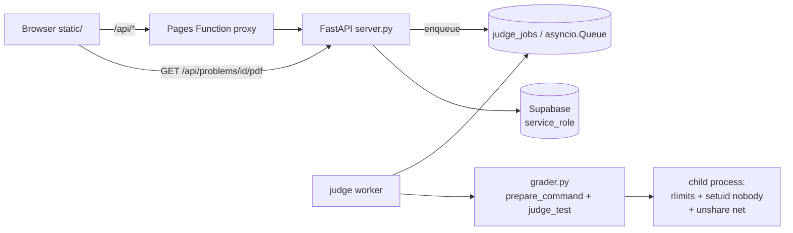

# agent.md — คู่มือสำหรับ AI session ใหม่ (อ่านไฟล์นี้ก่อนเสมอ)

> **ภาษาตอบผู้ใช้**: ไทย สั้น กระชับ ห้ามใช้อีโมจิ
> **หลักการสูงสุด**: ห้ามเดา — ทุกข้อสรุปต้องมาจากการรันจริง (CLI judge / curl / unittest / เบราว์เซอร์)
> **ถ้าแก้โค้ด**: รันชุดตรวจในข้อ 12 ก่อน commit เสมอ แล้ว deploy ตามข้อ 11

---

## 0. TL;DR สำหรับคนที่เพิ่งเปิด session (อ่าน 12 บรรทัดนี้ก่อน แล้วค่อยลงรายละเอียด)

1. โปรเจกต์ = เว็บสนามสอบเขียนโปรแกรม (Python/C/C++) ชื่อ **Newbiegrader** โจทย์ 47 ข้อ ทุกข้อมีเลข (`config.json → "no"`) ใช้เรียง/ค้นหา
2. Frontend = `static/` HTML/CSS/JS ล้วน **ห้ามมี build step** · Backend = `server.py` (FastAPI) · Engine = `grader.py` (stdlib ล้วน)
3. **ห้ามเขียน logic การตรวจซ้ำ** — ใช้ `grader.run_one/judge_test/prepare_command` เท่านั้น
4. ส่งงานเป็น **async job**: `POST /api/submit` → 202 + `job_id` → client poll `GET /api/jobs/{id}` (ห้ามกลับไปตรวจ inline ใน request)
5. **ห้ามคืนข้อมูลเทสต์ลับ**: ผลลัพธ์ต้องผ่าน `_redact_results()` และเก็บลง DB ที่ระดับ `REVEAL_SAMPLES` เท่านั้น
6. Endpoint ที่เสิร์ฟโจทย์/เทสต์/ไฟล์ ต้องใช้ `_visible_problem_or_404(pid, email)` (ไม่ใช่ `_problem_or_404`) ไม่งั้นโจทย์ชุดคอนเทสต์รั่ว
7. หลังแก้ `static/app.js` หรือ `styles.css` ต้อง bump `?v=N` ใน `static/index.html`
8. หลังเพิ่ม/แก้โจทย์ ต้อง **restart server** (problems โหลดตอน boot)
9. เปลี่ยน DB ต้อง append ลง `supabase/schema.sql` (`if not exists` เสมอ) แล้ว **ให้ user รันใน SQL Editor** (agent รัน DDL เองไม่ได้)
10. Deploy: `git push origin main` (frontend) + `git push deploy HEAD:deploy` (backend, build 3-5 นาที) — deploy **backend ก่อน** ถ้า frontend พึ่ง API ใหม่
11. ก่อน commit: `python3 -m unittest discover -s tests -v` + `python3 tools/validate_problem.py` + `node --check static/app.js && node tools/check_frontend.js`
12. ถ้าติดปัญหา ให้ดูข้อ 15 "กับดักที่เจอแล้ว" — เกือบทุกอาการแปลก ๆ ที่เจอมา อยู่ในนั้นแล้ว

---

## 1. ภาพรวมโปรเจกต์

### 1.1 หลักการออกแบบ (อย่าละเมิด)

- **โหดจริง**: TL/MEM ตาม PDF, checker เข้ม, เทสต์ลับเยอะ (hidden) — ไม่ใช่ playground
- **ไม่บอกใบ้**: `statement.md` ห้ามมี section "กับดัก"/"คำใบ้" (นโยบายผู้ใช้)
- **ไม่มี build step**: frontend vanilla, ห้ามเพิ่ม bundler/TS/React — เพิ่มได้แค่ไฟล์ static (หรือ vendor ไลบรารีที่โหลดได้ตรง ๆ)
- **มีที่เดียว**: judge logic อยู่ที่ `grader.py` ที่เดียว, schema อยู่ที่ `supabase/schema.sql` ที่เดียว, deploy = git push เท่านั้น
- **verify ด้วยการรัน**: งานทุกอย่างต้องมีหลักฐานการรัน (curl output, unittest, CLI verdict, screenshot เบราว์เซอร์)

### 1.2 สถานะปัจจุบัน (ตัวเลขจริง ณ วันที่เขียน)

| อะไร | ค่า |
|---|---|
| โจทย์ทั้งหมด | 47 (`problems/*/config.json`) — ทุกข้อสาธารณะตอนนี้ (ระบบรองรับข้อชุดคอนเทสต์ที่ `"hidden": true`) |
| เทสต์ทั้งหมด | 681 ไฟล์ `.in/.out` (ข้อละ 10-18) |
| Reference solution | `examples/<id>_ref.py` (+ `_ref.cpp` บางข้อ) รวม 59 ไฟล์ |
| เทสต์อัตโนมัติ | 39 เทสต์ ใน `tests/` (E2E 31 + cgroup 8) |
| checker | `token` (default) / `exact` / `float` / `decimal2` |
| เลขโจทย์ | ทุกข้อมี `config.json → "no"` เลข 1..47 ไม่ซ้ำ — เรียง/ค้นหา/เปิดด้วยเลขได้ |
| engine version | `grader.GRADER_VERSION = "2.0.0"` (เก็บทุก submission) |
| โจทย์ชุดคอนเทสต์ | 0 ข้อตอนนี้ (mechanism พร้อมใช้: `"hidden": true` + `contests.hide_from_tasks`) |

---

## 2. URLs / โฮสต์ / บัญชี

| อะไร | ค่า | หมายเหตุ |
|---|---|---|
| Production frontend | `https://gradernew.pages.dev` | Cloudflare Pages, output = `static/`, auto-deploy ทุก push `main` |
| Production backend | `https://grader.n.onjrnm.vip` | justrunmy (Docker), push `HEAD:deploy` แล้วมัน rebuild+restart เอง |
| Local dev | `http://127.0.0.1:8000` (`python3 server.py --port 8000`) | same-origin, ไม่ต้อง CORS |
| GitHub | `sphetpitak-sudo/gradernew` branch `main` | remote ชื่อ `origin` |
| Deploy remote | remote ชื่อ `deploy` → `https://justrunmy.app/git/r_Yr29N` | ⚠️ URL ใน `.git/config` ฝัง credential ไว้ (ห้าม commit/ห้าม paste ลง chat) |
| Supabase project | `synyixryyoytbdaxnmph.supabase.co` (Tokyo) | รัน `supabase/schema.sql` ใน SQL Editor |
| Admin | อีเมลใน env `ADMIN_EMAILS` (default ในโค้ด = เมลเจ้าของ) | เปิดสิทธิ์ `/api/admin/*`, ดู submission ของคนอื่น, เห็นโจทย์ที่ซ่อน |
| **โฮสต์ prod จริง** | **0.5 vCPU / 512 MB** | ค่าที่ derive ได้: workers 1, tests/submission 1, memory cap 256MB, queue max 25, overall timeout 240s, sample interval 20ms, compile timeout 90s |

**ลำดับความสำคัญเวลา host เล็ก**: อย่าเพิ่มงานที่กิน CPU/TIME พร้อมกันหลายตัว — ตั้ง workers/jobs = 1 เสมอถ้า CPU < 2

---

## 3. โครง repo (ใครแก้อะไรได้)

```
grader.py                  engine: run_one/judge_test/checkers/CLI/sandbox/limits + cpu_quota()/ram_limit_mb()/tests_hash()
server.py                  FastAPI: /api/* ทั้งหมด + คิวงาน + policy การเฉลย + serve static/ + โหลด .env local
static/index.html          ทุก view (section.view#view-*) + nav + SVG sprite <symbol id="i-*"> + script ?v=N
static/app.js              router + fetch helpers + render ทุกหน้า + state กลาง (ไฟล์เดียว ห้ามแยกโดยไม่มีเหตุผล)
static/styles.css          ธีม (CSS vars) + component ทั้งหมด; dark mode = [data-theme="dark"]
static/config.js           GRADER_API_BASE (prod ปล่อย "" = same-origin ผ่าน proxy)
functions/api/[[proxy]].js Cloudflare Pages Function: proxy /api/* → backend (คง Set-Cookie หลายตัว)
problems/<id>/             config.json + statement.md + statement.pdf + tests/NN.in|NN.out
examples/<id>_ref.py       reference solution (single source of truth ตอน gen test)
tools/validate_problem.py  ตรวจโจทย์ทั้งชุด (config/tags/เทสต์/ตัวอย่าง/ref ต้อง AC) — รันใน CI
tools/problem_visibility.py ตั้ง hidden/public ของโจทย์ + --list
tools/number_problems.py   จัดการเลขโจทย์ (--list/--assign/--renumber/--set/--check)
tools/plagiarism.py        ตรวจการก็อปโค้ด (winnowing, stdlib) + self-test ใน __main__
tools/check_frontend.js    เช็ค $("id") ใน app.js ว่ามีจริงใน index.html หรือใน template literal
tools/make_statement_tex.py สร้าง statement.pdf (LaTeX/tectonic + TH Sarabun, build นิ่ง byte-identical)
tools/fonts/               ฟอนต์สำหรับ PDF
tests/fake_supabase.py     in-memory stand-in ของ supabase client (ตาราง + view + column whitelist)
tests/test_api_e2e.py      E2E ผ่าน TestClient (คิวงาน/สิทธิ์/คอนเทสต์/quota/redact/migration fallback)
tests/test_host_limits.py  unit test การอ่าน cgroup (CPU/RAM → ตั้งค่า judge)
supabase/schema.sql        schema + migration ทั้งหมด (append-only)
.github/workflows/ci.yml   CI: compileall + node checks + validator + plagiarism self-test + unittest
Dockerfile                 backend image (python:3.11-slim + gcc/g++) + chmod -R go-rwx problems
.env.example               template env (คีย์ครบ + ค่า auto) — ห้าม commit .env จริง
agent.md                   ไฟล์นี้
README.md                  คู่มือผู้ใช้/deploy/env
```

**กติกาว่าใครแก้อะไร**: `grader.py` + `server.py` = ไฟล์ที่คุมการตัดสิน → ห้ามมี agent หลายตัวแก้พร้อมกัน (ให้เจ้าของเดียวต่อรอบ) · `static/app.js` ก็เช่นกัน

---

## 4. สถาปัตยกรรม

### 4.1 เส้นทาง request



### 4.2 วงจรการตรวจ (async job) — หัวใจของระบบ

1. `POST /api/submit` (multipart: `problem`, `language`, `code`|`file`, `contest?`)
   - ตรวจ login → ตรวจการมองเห็นโจทย์ (`_visible_to`) →ตรวจคอนเทสต์ (อยู่ในรายการ + อยู่ในช่วงเวลา)
   - `_quota_check("submit", email, SUBMIT_QUOTA)` → 409 ถ้าคนเดิมมีงานค้าง → 503 ถ้า `_queue_depth() >= QUEUE_MAX`
   - อ่านโค้ด (`_read_source`: จำกัด 256KB, เช็คนามสกุลตรงภาษา) → `_create_job()` → `202 {job_id, status:"queued", samples, hidden_tests}`
2. `_create_job()`: insert ลงตาราง `judge_jobs` (ถ้ามี DB) แล้ว `_queue().put(job_id)`; ถ้า insert ไม่ได้ (ยังไม่รัน migration) → ใช้คิว in-memory แล้ว log เตือน
3. `_judge_worker()` (มี `JUDGE_WORKERS` ตัว, สร้างตอน lifespan): `await _queue().get()` → `_run_job()`
4. `_run_job()`: `run_submission(prob, ext, source, reveal)` ในเทรด (`asyncio.to_thread`) ครอบด้วย `OVERALL_TIMEOUT`
5. `run_submission()`: compile (ถ้าต้อง) → `grader.judge_test` ต่อเทสต์ (ขนาน `JUDGE_JOBS` ตัว) → คืนผลพร้อม `public: true/false` ต่อเทสต์ → `_redact_results(results, reveal)`
6. `_finish_job()`: เขียนผลกลับ `judge_jobs` (เวอร์ชันที่ redact แล้ว) + `_store_submission()` ลง `submissions` (แถวเดียวต่อ 1 การส่ง; rejudge = update แถวเดิม)
7. Client poll `GET /api/jobs/{id}` ทุก ~700ms (สูงสุด 4 นาที) แล้วเอา `job.result` ไป render

**สถานะ/รหัสตอบที่ต้องรู้**: 202 = เข้าคิว · 401 = ยังไม่ login · 409 = มีงานค้าง · 429 = เกินโควตา (มี `Retry-After`) · 503 = คิวเต็ม (มี `Retry-After`) · 504 = งานเกินเวลา · job `status`: `queued|running|done|error`

**Recovery**: ตอน boot `_recover_jobs()` จะ `running → queued` ทั้งหมดแล้ว enqueue คืน (งานที่ค้างข้าม restart ไม่หาย — ถ้ามี DB); งานที่เก่ากว่า `JOB_MAX_AGE_S` จะถูก mark error

### 4.3 นโยบายการเฉลย (สำคัญที่สุดด้านความปลอดภัย)

| ระดับ | ใครเห็น | เงื่อนไข |
|---|---|---|
| `REVEAL_ALL` | admin | เห็น input/expected/actual/diff ทุกเทสต์ |
| `REVEAL_SAMPLES` | ผู้ใช้ทั่วไป (default) | เห็น input/expected เฉพาะเทสต์ที่อยู่ใน `config.json → samples` |
| `REVEAL_NONE` | ระหว่างแข่ง (คอนเทสต์ที่ตั้ง `show_samples=false` + status = running) | ไม่เห็นข้อมูลเทสต์เลย |

- เทสต์ที่ไม่อยู่ใน `samples` = **เทสต์ลับ** → คืนแค่ `test/verdict/wall_s/cpu_s/peak_mb/hidden:true` (+ `detail` ของ stderr เฉพาะ RE/TLE/MLE ซึ่งเป็นข้อผิดพลาดของผู้ส่งเอง)
- `_redact_results()` ทำงาน **2 จุด**: ก่อนคืน response และก่อนเก็บลง DB (เก็บที่ระดับ `REVEAL_SAMPLES` เสมอ) → แถวใน DB จึงรั่วเทสต์ลับไม่ได้แม้จะอ่านด้วยสิทธิ์อื่น
- `/api/history/{sid}` = เจ้าของหรือ admin เท่านั้น · `/api/history` (สาธารณะ) กรองโจทย์ที่ซ่อนออกให้คนที่ไม่ใช่ admin
- `/api/problems/{id}/sample/{name}` = 404 ถ้าไม่ใช่ sample สาธารณะ

### 4.4 Sandbox (ตายยาก อย่าถอด)

`grader.build_limits()` (preexec ของ child):
- `RLIMIT_AS`/`RLIMIT_DATA` = memory limit ที่ใช้จริง (ถูก cap ที่ `MEMORY_CAP_MB`)
- `RLIMIT_CPU` = `int(TL)+2` (กัน loop อนันต์ไม่ให้กิน CPU เกิน), `RLIMIT_NPROC=64` (fork bomb), `RLIMIT_FSIZE=64MB`, `RLIMIT_CORE=0`, `RLIMIT_NOFILE=64`
- บน Linux ที่รันเป็น root (prod Docker): `unshare(CLONE_NEWNET)` ก่อน แล้ว `setgroups([])` + `setgid/setuid(nobody)` — **best effort** ทั้งหมด (ล้มเหลวแล้วใช้ rlimits ต่อ ไม่ throw)
- env ของ child = `judge_env()` (PATH, LANG, HOME/TMPDIR=/tmp) — **ความลับไม่รั่วเข้า child**
- workdir/binary ถูก `chmod 0755` ก่อนรัน และ image ทำ `chmod -R go-rwx problems` เพื่อไม่ให้ child อ่านเทสต์ได้

### 4.5 Capacity: อ่านจาก cgroup เอง (ห้าม hardcode)

`grader.cpu_quota()` / `grader.ram_limit_mb()` อ่าน cgroup v2 (`/sys/fs/cgroup/cpu.max`, `memory.max`) → v1 (`cpu.cfs_quota_us`, `memory.limit_in_bytes`) → fallback `cpu_count()`/RAM รวม; `GRADER_CGROUP_ROOT` override ได้ (ใช้ในเทสต์)

`server.py` แปลงเป็น (ทุกตัว: **0/ไม่ตั้ง = auto, ค่าบวก = override**):

| ตัวแปร | สูตร auto | ค่าบน prod (0.5 vCPU / 512MB) |
|---|---|---|
| `JUDGE_WORKERS` | `2 ถ้า cpu ≥ 2 ไม่งั้น 1` | **1** |
| `JUDGE_JOBS` (เทสต์ขนานต่อ 1 งาน) | `4 ถ้า cpu ≥ 2 ไม่งั้น 1` | **1** |
| `MEMORY_CAP_MB` | `ram × 0.5` (ขั้นต่ำ 64) | **256** |
| `QUEUE_MAX` | 25 | 25 |
| `OVERALL_TIMEOUT` | `90 ถ้า cpu ≥ 2 ไม่งั้น 240` | 240s |
| `COMPILE_TIMEOUT` (grader) | `60 ถ้า cpu ≥ 2 ไม่งั้น 90` | 90s |
| `SAMPLE_INTERVAL` (grader) | `0.005 ถ้า cpu > 1 ไม่งั้น 0.02` | 20ms |

- ค่าที่ใช้จริงดูได้ที่ `GET /api/version → system` และบรรทัด `[web] host: ...` ตอน boot
- `MEMORY_CAP_MB` ทำให้โจทย์ที่ประกาศ 512MB ถูกตัดเหลือ 256MB → รายงาน `limits.capped=true` + `memory_mb` (ค่าที่ใช้จริง) + `declared_mb` และ UI โชว์ "(เครื่องตัดที่ X MB จาก Y MB)" — **อย่าถอด cap** เพราะ 512MB process ใน container 512MB = OOM killer ฆ่า server

### 4.6 คอนเทสต์แบบ Codeforces (register → เปิดโจทย์ตอนเริ่ม → คะแนนอยู่แต่ในคอนเทสต์)

| เฟส | ผู้ใช้ทั่วไป | ผู้ที่ลงทะเบียน | admin |
|---|---|---|---|
| `upcoming` (ก่อนเริ่ม) | กด **Register** ได้, อ่านโจทย์ไม่ได้ (โจทย์ชุดคอนเทสต์ตอบ 404) | อ่านโจทย์ยังไม่ได้, ยกเลิกลงทะเบียนได้ | ทุกอย่าง + เห็นรายชื่อผู้ลงทะเบียน |
| `running` | ส่งไม่ได้ (403 "ยังไม่ได้ลงทะเบียน") | อ่านโจทย์ + ส่งได้ ยกเลิกลงทะเบียนไม่ได้ | ทุกอย่าง |
| `ended` | อ่านโจทย์ได้ (practice) แต่ส่งไม่ได้ | เหมือนผู้ใช้ทั่วไป | ทุกอย่าง |

- ตาราง `contest_registrations (contest_id, user_email, name, registered_at)` + `POST/DELETE /api/contests/{cid}/register`
- **คะแนนในคอนเทสต์ไม่ขึ้นบอร์ดกลาง**: view `leaderboard_scores`/`problem_stats` และ fallback scan กรอง `contest_id is null` ออก
  (คะแนนไปอยู่ที่ `GET /api/contests/{cid} → scoreboard` เท่านั้น) และหน้า Tasks คิด "Solved/points" จากแถวที่ไม่มี `contest_id`
- ถ้ายังไม่รัน migration (ไม่มีตาราง registrations) ระบบจะ **ไม่บังคับลงทะเบียน** (ทุกคนส่งได้เหมือนเดิม) + log เตือน — กันคนใช้พังทั้งคอนเทสต์
- ต้องเป็น admin จึงจะสร้าง/แก้คอนเทสต์ — และหน้าจัดการย้ายไปอยู่ `#/admin` แล้ว (ดูข้อ 8)

### 4.7 การมองเห็นโจทย์ (visibility) — 3 ชั้น

```
สาธารณะ (ขึ้นหน้า Task/Archive)
   └─ โจทย์ในคอนเทสต์ที่ hide_from_tasks = false
ซ่อนจากหน้า Task แต่เข้าถึงได้ทางหน้าคอนเทสต์ + admin
   ├─ config.json "hidden": true        (ถาวร — ไม่ผูกกับคอนเทสต์)
   └─ อยู่ในคอนเทสต์ที่ hide_from_tasks = true
```

- กรองที่: `/api/problems`, `/api/health`, `/api/version`, `/api/history` (สาธารณะ), `/api/problems/{id}(/sample/pdf)`, `POST /api/submit`, `POST /api/run`
- admin เห็นครบ + ธง `hidden` / `contest_only` / `config_hidden` / `contest_hidden` ใน `/api/problems`
- โจทย์ที่ถูกซ่อนจะ **อ่านได้เมื่อคอนเทสต์ที่ระบุโจทย์นั้น "เริ่มแล้ว"** (running/ended) หรือเป็น admin — ก่อนเริ่ม = 404 (กันเห็นโจทย์ก่อนเวลา)
- cache ของชุดนี้คือ `_contest_pid_cache` (TTL 20s) — **ต้อง `_contest_pid_cache["at"] = 0.0` ทุกครั้งที่คอนเทสต์เปลี่ยน** (upsert/delete ทำให้แล้ว) และ `_reg_count_cache` สำหรับจำนวนผู้ลงทะเบียน
- ตัวอย่างจริง: ดูเทสต์ `test_contest_problems_are_hidden_from_the_task_list` (สร้างคอนเทสต์ที่ซ่อน `hanoi` แล้วเช็คว่าหายจากหน้า Task แต่เปิดได้จากหน้าคอนเทสต์)

---

## 5. Data model (`supabase/schema.sql`)

| ตาราง/วิว | คอลัมน์สำคัญ | ใช้ทำอะไร |
|---|---|---|
| `submissions` | `id, created_at, problem, language, filename, name, user_email, verdict(AC/REJECTED/CE), accepted, passed, total, score, counts jsonb, results jsonb (redacted), code, detail` + migration: `tests_hash, grader_version, kind(submit/rejudge), contest_id, job_id` | ประวัติการส่ง + หลักฐานว่าตัดสินด้วยเทสต์ชุดไหน/engine เวอร์ชันใด |
| `profiles` | `user_email (pk), display_name, default_language` | ชื่อที่โชว์ + ภาษาเริ่มต้น (ชื่อนี้ทับชื่อใน submissions เสมอ) |
| `reports` | `id, created_at, problem, kind(statement/tests/other), message, user_email, name, status(open/closed)` | รีพอร์ตโจทย์พัง |
| `users` | `email (pk), name, password_hash, created_at` | บัญชีรหัสผ่าน (Google ไม่เก็บ) |
| `judge_jobs` | `id, status(queued/running/done/error), kind, user_email, name, problem, language, filename, contest_id, source, target_id, result jsonb, error, tests_hash, grader_version, reveal, started_at, finished_at` | คิวงาน durable — restart ไม่ทำ job หาย |
| `contests` | `id (slug), title, starts_at, ends_at, problems jsonb, freeze_minutes, show_samples, hide_from_tasks, created_by` | คอนเทสต์ + นโยบายโชว์ |
| `contest_registrations` | `contest_id, user_email, name, registered_at` (pk = contest_id+user_email) | ใครกด Register (บังคับก่อนส่งในคอนเทสต์) |
| view `leaderboard_scores` | `user_email, problem, best, accepted, last_at, name` — **กรอง `contest_id is null`** | all-time best ต่อคนต่อข้อ (คะแนนในคอนเทสต์ไม่นับ) |
| view `problem_stats` | `problem, subs, accepted, best, total_score, solvers` — **กรอง `contest_id is null`** | สถิติต่อข้อ |

- **RLS เปิดทุกตาราง ไม่มี public policy** — เข้าถึงได้ทาง `service_role` ฝั่ง backend เท่านั้น (ห้ามใช้ anon key)
- migration ทั้งไฟล์ใช้ `if not exists` / `create or replace` → รันซ้ำได้ปลอดภัย
- ลำดับการอ่าน fallback ในโค้ด: ถ้า view ไม่มี → สแกน `submissions` จำกัด 2000/500 แถว (พร้อม log เตือน "run supabase/schema.sql")
- **DDL agent รันเองไม่ได้** → append ในไฟล์แล้วบอก user รันใน SQL Editor

---

## 6. API reference

ทุก endpoint อยู่ใต้ `/api` · ต้อง login = ใช้ session cookie `ng_session` (HttpOnly, SameSite=lax)

| Method | Path | สิทธิ์ | หมายเหตุ |
|---|---|---|---|
| GET | `/api/health` | – | `{ok, problems:[...], count}` (กรองโจทย์ที่ซ่อน) |
| GET | `/api/languages` | – | python/c/cpp |
| GET | `/api/version` | – | `GRADER_VERSION` + hash เทสต์ทุกข้อ + `system`(capacity); admin ได้ `hidden_problems`, `problems_total` |
| GET | `/api/problems` | – | รายการโจทย์ เรียงตามเลข (`?sort=difficulty` = เรียงตามระดับ; admin ได้ธง visibility) |
| GET | `/api/problems/{pid}` | ตาม visibility | statement + `samples`, `hidden_tests`, `tests_hash` |
| GET | `/api/problems/{pid}/sample/{name}` | ตาม visibility | ตัวอย่างสาธารณะเท่านั้น |
| GET | `/api/problems/{pid}/pdf` | ตาม visibility | inline PDF |
| POST | `/api/submit` | login | **202 + job_id** (409/429/503) |
| GET | `/api/jobs/{jid}` | เจ้าของ/admin | `{status, error, result, queued_ahead}` |
| POST | `/api/run` | login | playground (stdin ของผู้ใช้, ไม่บันทึกประวัติ) ใช้โควตา `RUN_QUOTA` |
| GET | `/api/history` | – (`?mine=1` ต้อง login) | ลิสต์การส่ง (กรองโจทย์ที่ซ่อนถ้าไม่ใช่ admin) |
| GET | `/api/history/{sid}` | เจ้าของ/admin | **ทั้งแถวรวม `code`** — ห้ามเปิดให้คนอื่น |
| POST | `/api/report` | login | แจ้งโจทย์พัง (kind ∈ statement/tests/other, ข้อความ 1-1000 ตัว) |
| GET | `/api/reports` | login (`?all=1` admin) | – |
| PUT | `/api/reports/{rid}` | admin | ปิดรีพอร์ต |
| GET | `/api/leaderboard` | – | all-time (view + fallback) · ชื่อ: profile → ชื่อใน submissions → local-part ของอีเมล |
| GET | `/api/stats` | – | สถิติต่อข้อ (view + fallback) |
| GET | `/api/contests` | – | ลิสต์คอนเทสต์ (+ `hide_from_tasks`) |
| GET | `/api/contests/{cid}` | – | รายละเอียด + `problem_details` + `scoreboard` + `registered`/`participants`/`problems_open`/`can_submit`/`starts_in_s`/`ends_in_s` (admin ได้ `participants_list`) |
| POST | `/api/contests` | admin | upsert คอนเทสต์ (validate slug/เวลา/รายชื่อโจทย์ รับเลขโจทย์ได้) |
| POST | `/api/contests/{cid}/register` | login | ลงทะเบียนคอนเทสต์ (ปิดรับหลังจบ) → `{registered, participants}` |
| DELETE | `/api/contests/{cid}/register` | login | ยกเลิกลงทะเบียน (ระหว่างแข่งทำไม่ได้, admin ยกเว้น) |
| DELETE | `/api/contests/{cid}` | admin | ลบ (การส่งยังอยู่) |
| POST | `/api/admin/rejudge` | admin | `{ids:[...]}` หรือ `{problem, limit}` → คืน job ids (batch ≤ `QUEUE_MAX`) |
| GET | `/api/admin/plagiarism` | admin | `?problem=&threshold=&limit=` → คู่ที่คล้ายกัน |
| GET | `/api/admin/overview` | admin | users/subs/per_problem/recent + `jobs`(คิว) + `problems_contest_only` |
| GET/POST | `/api/auth/login`, `/api/auth/callback`, `/api/auth/finish` | – | Google OAuth (one-time token → cookie first-party) |
| GET/POST | `/api/auth/me`, `/api/auth/logout` | – / login | `/me` คืน `{user, is_admin, profile}` |
| POST | `/api/auth/register`, `/api/auth/password` | – | รหัสผ่าน (PBKDF2 210k) + rate limit รายบัญชี |
| GET/PUT | `/api/profile` | login | ชื่อที่โชว์ + ภาษา default |

**เลขโจทย์ (`no`)**: ทุก endpoint ที่รับ `{pid}` รับ "เลข" แทน slug ได้ (`/api/problems/19`, `/api/problems/19/sample/02`, `POST /api/submit problem=19`, `?problem=19` ใน history/reports/plagiarism/rejudge) — ใช้ `_resolve_pid()` แปลงเป็น slug; `contests.problems` เก็บเป็น slug เสมอ (normalize ตอน upsert/อ่าน) และ `PROBLEMS_BY_NO` ถูกสร้างตอน boot (เตือนถ้าเลขซ้ำ)

**Rate limit auth** (`_check_rate_limit(request, email)`): ต่อบัญชี 8 ครั้ง/15 นาที (`ACCOUNT_MAX_TRIES`, สำเร็จ = `_clear_account_attempts`) + ต่อ IP 200 ครั้ง/5 นาที (`LOGIN_MAX_TRIES`) — **ห้ามตั้ง per-IP ต่ำ** เพราะทุกคนผ่าน proxy มาด้วย IP เดียวกัน (ดูข้อ 15.5)

---

## 7. Workflow: เพิ่มโจทย์

### 7.1 โจทย์ทั่วไป (จาก PDF)

1. ผู้ใช้วาง PDF → `git mv` เป็น `problems/<id>/statement.pdf` (id ตัวเล็ก snake_case)
2. ถ้าโจทย์เป็นอังกฤษ/ไม่มี PDF ไทย: เขียน `statement.md` ไทยเอง (เก็บเรื่องราวครบ ห้ามย่อ) แล้วสร้าง PDF ด้วย
   `python3 tools/make_statement_tex.py <id>` (tectonic + TH Sarabun, build นิ่ง byte-identical, footer `Newbiegrader | หน้า`)
   → **verify ด้วย `pdftotext` + เปิดดูภาพทุกข้อก่อน commit**
3. เขียน `statement.md`: เรื่องราว + `## Input` + `## Output` + `## ตัวอย่าง` (fenced block `input:`/`output:`) + `## Limits` (+ `## Subtasks` ถ้ามี) — **ห้ามมี section ใบ้**
4. `config.json` (ดูข้อ 7.3) — ถ้าตัวอย่างใน statement ตรงกับเทสต์ข้อไหน ให้ใส่ `samples` เป็นชื่อเทสต์นั้น
5. `tests/NN.in|NN.out` (10+ ข้อ): ข้อที่เป็นตัวอย่างใน PDF ต้องตรงเป๊ะ + edge + random (seeded) + max constraint
6. `examples/<id>_ref.py` reference solution
7. verify 3 ชั้น: (ก) ตัวอย่างตรง PDF (ข) gen กับ ref ตรงกัน (ค) cross-check อิสระ (greedy vs DP, Miller-Rabin + Pollard-Rho ฯลฯ)
8. `python3 tools/number_problems.py --assign` ให้เลขโจทย์ใหม่ (ต่อท้าย) — validator จะ FAIL ถ้าไม่มีเลข/เลขซ้ำ
9. `python3 grader.py run <id> examples/<id>_ref.py` ต้อง `ACCEPTED N/N` + ลอง solution ผิดต้องได้ WA (กันเทสต์หลวม)
10. `python3 tools/validate_problem.py <id>` ต้อง **0 FAIL** (บรรทัด OK จะขึ้น `#<no>`)
11. restart server → เทสบนเว็บ (ค้นหาด้วยเลขได้) → commit + push (ข้อ 11)

### 7.2 โจทย์ชุดคอนเทสต์ (ไม่โชว์ในหน้า Task)

ทำเหมือนข้อ 7.1 แล้วเพิ่ม:
1. `python3 tools/problem_visibility.py --id <id> --hidden` (ดูทั้งหมด `--list`, ยกเลิก `--public`)
2. validator จะขึ้นท้ายบรรทัด OK ว่า `[contest-only: ไม่โชว์ในหน้า Task]`
3. deploy แล้วไปสร้างคอนเทสต์ในหน้า admin (Settings) → เลือกโจทย์ (ข้อที่ซ่อนจะถูกเรียงบนสุด + มีป้าย) → ติ๊ก "ซ่อนโจทย์ชุดนี้จากหน้า Task" (default เปิด)
4. ถ้าอยากใช้โจทย์สาธารณะในคอนเทสต์แบบไม่ซ่อน → ปิดติ๊กนั้น (`hide_from_tasks = false`)
5. ต้องรัน SQL `alter table contests add column if not exists hide_from_tasks boolean not null default true;` ก่อน (ไม่งั้น `POST /api/contests` ตอบ 400 พร้อมบอก)

**ตัวอย่าง**: เวลารับโจทย์ชุดแข่ง ให้สร้างโฟลเดอร์โจทย์ + ตั้ง `hidden` + `tools/validate_problem.py` + สร้างคอนเทสต์ในหน้า admin (ดูเทสต์ `test_contest_problems_are_hidden_from_the_task_list` เป็นสเปกพฤติกรรม)

### 7.3 `config.json` reference

```json
{
  "title": "ชื่อไทย (English)",
  "time_limit": 1.0,              // วินาที (wall clock) — validator บังคับ 0 < x ≤ 60
  "memory_limit": 256,            // MB — validator บังคับ 16..4096 (ถูก cap ที่ MEMORY_CAP_MB อีกชั้น)
  "checker": "token",             // token | exact | float | decimal2
  "tolerance": 1e-6,              // ใช้กับ checker float
  "difficulty": "easy",           // easy | medium | hard (ใช้เรียง/กรองใน UI)
  "tags": ["Implementation"],     // ต้องอยู่ใน KNOWN_TAGS ของ grader.py (25 แท็ก)
  "notice": "ข้อนี้ใช้อะไรก็ได้",   // แบนเนอร์บนหน้า task (ไม่ใส่ = ไม่มี)
  "samples": ["02"],              // ชื่อเทสต์ที่เป็นตัวอย่างสาธารณะ (ที่เหลือ = เทสต์ลับ)
  "hidden": true,                 // โจทย์ชุดคอนเทสต์ (ไม่โชว์หน้า Task)
  "no": 19                        // เลขโจทย์ (บังคับ! ไม่ซ้ำ, >= 1) — tools/number_problems.py
}
```

- เทสต์ถูกเรียงตามชื่อไฟล์ (`01, 02, ...`) — `samples` ต้องเป็นชื่อไฟล์ที่มีจริง (validator ฟ้องถ้าไม่มี/ซ้ำ)
- checker: `token` = เทียบทีละโทเคน (ตัด whitespace) · `exact` = byte ต่อบรรทัด (ผ่อน newline ท้ายไฟล์) · `float` = tolerance · `decimal2` = ทศนิยม 2 ตำแหน่ง
- KNOWN_TAGS: Implementation, Math, Ad-hoc, String, Data Structure, DP, Sweepline, Greedy, DFS, Bitmasks, Binary Search, Graph, DSU, Sorting, Sliding Window, Divide and Conquer, Matrix Exponential, Tree, Fixed Parameter, Hashing, Geometry, NP, Recursive, Linear Algebra, Matching

---

## 8. Workflow: แก้ frontend (`static/`)

- **ไม่มี build/restart** (StaticFiles อ่านจาก disk ทุก request) แต่ Pages ต้อง redeploy (auto จาก push `main`)
- **bump `?v=N` ทุกครั้ง** ที่แก้ `app.js`/`styles.css` (ปัจจุบัน `app.js?v=12`, `styles.css?v=9`, `config.js?v=4`) — กัน cache ค้าง
- ห้าม emoji ใน UI · icon ใช้ SVG sprite (`<symbol id="i-*">` ใน index.html + helper `icon(name, cls)`)
- โครง JS: `state` กลาง (ที่ต้นไฟล์) · router = hash (`router()` + `currentRouteRender()`) · fetch ผ่าน `apiFetch/apiGet/apiPostJson/apiPostForm/apiDelete` (แนบ `detail` ของ server มาเสมอ) · `pollJob(jid, onTick)` สำหรับงาน async (700ms, เพดาน 4 นาที) · `esc()` ก่อนแทรก HTML เสมอ · `badge()/icon()/scoreCls()/limitsMeta()`
- เลขโจทย์: `noLabel(p)` = chip `#19` ใช้บนการ์ด/หัวข้อ/ตาราง; ช่องค้นหารับ `19` และ `#19`; `#/task/19` เปิดด้วยเลข (router ใช้ `resolveTaskToken()`/`openTaskByToken()` — เลขที่ไม่พบในลิสต์จะลองยิง API ต่อ เช่นโจทย์ชุดคอนเทสต์); เรียงได้ 3 แบบผ่าน `#f-sort` (`state.filter.sort` + `sortProblemList()`, จำค่าใน `localStorage.ng_sort`)
- หน้า **admin แยกจาก Settings**: route `#/admin` + `renderAdmin()` — ลำดับการ์ด: ภาพรวม → **จัดการคอนเทสต์** → รีพอร์ต → rejudge/plagiarism (คอนเทสต์อยู่ใต้อภิมรรวมตามที่ผู้ใช้ต้องการ); nav link `#nav-admin` ซ่อนจนกว่า `state.is_admin` และ non-admin ที่เปิด `#/admin` จะถูกดีดกลับ `#/`; Settings เหลือโปรไฟล์เท่านั้น
- routes: `#/` `#/tasks` `#/task/<pid|no>` `#/archive` `#/leaderboard` `#/contests` `#/contests/<id>` `#/history` `#/settings` `#/admin` `#/login` `#/login/register`
- identity-dependent view: หลัง `refreshMe()` ใน `init()` ต้องเรียก `currentRouteRender()` (เคยเป็นบั๊ก: เปิด `#/settings` ตรง ๆ แล้วการ์ด admin หาย)
- cache: `localStorage["ng_problems_v1"]` (TTL 1 ชม.) — **ห้าม cache รายการแบบ admin** (มีโจทย์ที่ซ่อน) และต้อง `removeItem` ตอน logout
- หลังแก้visibility ของโจทย์ (สร้าง/ลบคอนเทสต์) ต้องเรียก `refreshProblems()` ไม่งั้นลิสต์ค้าง
- ตรวจก่อน commit: `node --check static/app.js` + `node tools/check_frontend.js` (`$("id")` ทุกตัวต้องมีจริง/อยู่ใน template literal)
- dark mode ผ่าน CSS vars (`--field`, `--on-acc`, `--muted`, `--border`, `--surface`, `--link`, `--dim`) — ห้าม hardcode สี

---

### 8.1 อย่าเปิดเผยจำนวนโจทย์ทั้งหมดใน UI (นโยบายผู้ใช้)

- header แสดงแค่ `online` (ไม่ใช่ `online - 47 ข้อ`) — `init()` ใน `app.js`
- หน้า Home ไม่มีการ์ด "โจทย์ทั้งหมด"
- `#filter-count` แสดงผลก็ต่อเมื่อ **มี filter/ค้นหาอยู่** (`พบ N ข้อ`) ถ้าไม่กรองก็ปล่อยว่าง
- ค่าที่ admin เห็น (เช่น "มี N ข้อซ่อนจากผู้ใช้ทั่วไป") เปิดได้เพราะเป็น admin-only
- ที่ยังเปิดเผยตัวเลขอยู่: หน้า Archive โชว์ `solved/total` ต่อระดับ (เป็นฟีเจอร์ progress) — ถ้าผู้ใช้ขอ ให้เปลี่ยนเป็นเปอร์เซ็นต์อย่างเดียว

## 9. Workflow: แก้ backend (`server.py` / `grader.py`)

- เทส local: `python3 -m unittest discover -s tests -v` (เร็วกว่า curl และไม่แตะ production)
- **คิวงาน**: ห้ามเรียก `run_submission()` จาก request handler (ยกเว้น `/api/run` ที่รันครั้งเดียวสั้น ๆ) — ต้องผ่าน `_create_job` + worker
- **การเฉลย**: เพิ่มฟิลด์ที่มีข้อมูลเทสต์ต้องผ่าน `_redact_results()` และคิดเรื่องเก็บลง DB ด้วย (`REVEAL_SAMPLES` เสมอ)
- **โจทย์ที่เสิร์ฟออกไป**: ใช้ `_visible_problem_or_404(pid, email)` ทุก endpoint ใหม่
- endpoint ที่เป็น `def` (sync) รันใน threadpool → **ห้ามเรียก `_queue()`** (ไม่มี running loop) ให้ใช้ `_queue_depth()`
- โควตา: `_quota_check(kind, email, ...)` · จำกัดงานพร้อมกันต่อคน: `_active_jobs[email]` (409)
- `ADMIN_EMAILS` = default ในโค้ด (override ผ่าน env) — endpoint ใต้ `/api/admin/*` และการอ่าน submission ของคนอื่นต้องเช็ค `_is_admin`
- CORS: ปล่อยว่าง = same-origin เท่านั้น (prod ใช้ proxy) — ถ้า frontend อยู่คนละโฮสต์ค่อยตั้ง `GRADER_CORS_ORIGINS` (และ `allow_methods` ต้องครบ + `allow_credentials=True`)
- Session: `ng_session` (HttpOnly, SameSite=lax, Secure ใน prod) — flow Google = `/api/auth/login` → Google → `/api/auth/callback` (ผ่าน proxy → session origin เดียวกัน) → mint one-time token → `/api/auth/finish` ตั้ง cookie first-party
- Login จำลองสำหรับเทส local (ไม่ต้องใช้ Google):
```python
from httpx import Client
c = Client(base_url="http://127.0.0.1:8000", timeout=90)
c.post("/api/auth/register", json={"email": "test@example.com", "password": "testpass123", "name": "t"})
# ครั้งต่อไปใช้ /api/auth/password — cookie ng_session ติดมาเอง
```
(ห้าม forge cookie เอง)

---

## 10. Workflow: DB migration

1. append ลง `supabase/schema.sql` (ท้ายไฟล์ + คอมเมนต์หัวข้อว่า migration รอบไหน) — ใช้ `if not exists` / `create or replace` เสมอ, ห้ามลบของเก่า
2. โค้ดต้อง **fallback ได้** ถ้า user ยังไม่รัน (ตัวอย่างที่มีในโค้ดแล้ว: insert ตัดคอลัมน์ใหม่ทิ้ง, aggregate สแกน 2000/500 แถว, คิว in-memory, contests ตอบ `configured:false`)
3. บอก user รันใน Supabase SQL Editor (agent ทำไม่ได้) + บอกผลถ้าไม่รัน
4. เทส local ไม่ต้องมี DB จริง: ใช้ `tests/fake_supabase.py` (`columns=`, `missing=`, `views=`, `view_columns=`) จำลองทั้งสถานะ "ยังไม่รัน migration"
5. Production มีข้อมูลจริง — ถ้าเทสด้วย DB จริง ต้อง**ลบข้อมูลเทสทุกครั้ง** (delete by id/email แล้วเช็ค count กลับเท่าเดิม) และห้าม `drop`/`reset` โดยไม่ได้รับคำสั่ง

---

## 11. Workflow: deploy

```bash
# 1) หน้าบ้าน (Pages auto-deploy)
git add -A && git commit -m "..." && git push origin main

# 2) หลังบ้าน (Docker rebuild 3-5 นาที; ใช้ remote ชื่อ deploy ที่ตั้งไว้ในเครื่องนี้)
git push deploy HEAD:deploy
```

- remote `deploy` ฝัง credential ใน URL ของ `.git/config` (local เท่านั้น ไม่ถูก commit) → **อย่า `git push -u` กับมัน** เพราะจะเปลี่ยน upstream ของ `main` ไปที่ deploy (เคยเกิดแล้ว ต้อง `git branch -u origin/main main` คืน)
- ลำดับสำคัญ: ถ้า frontend พึ่ง API ใหม่ → **deploy backend ก่อน** แล้วค่อย push `origin main`
- หลัง deploy verify:
```bash
curl -s https://grader.n.onjrnm.vip/api/health | head -c 120
curl -s https://grader.n.onjrnm.vip/api/version | python3 -m json.tool | head -20   # ดู engine + system
curl -s https://gradernew.pages.dev/ | grep -o 'app.js?v=[0-9]*'                    # frontend เวอร์ชันใหม่หรือยัง
```
- หลัง deploy backend ต้องแจ้ง user ถ้ามี migration ใหม่ + ให้ hard refresh (Ctrl+Shift+R) ถ้าแก้ frontend
- push บางครั้งขึ้น `send-pack: unexpected disconnect` แต่ ref ไปถึงแล้ว — เช็คด้วย `git ls-remote deploy deploy` เทียบกับ `git rev-parse HEAD`

---

## 12. Testing

### 12.1 ชุดคำสั่งที่ต้องรันก่อน commit (เรียงตามลำดับ)

```bash
python3 -m compileall -q grader.py server.py tools tests     # syntax
node --check static/app.js && node tools/check_frontend.js    # frontend syntax + ids
python3 tools/number_problems.py --check                     # เลขโจทย์ไม่ซ้ำ/ต่อเนื่อง
python3 tools/validate_problem.py                            # 47 ข้อ: config/เทสต์/ตัวอย่าง/ref ต้อง AC (16-25 วิ)
python3 tools/plagiarism.py                                  # self-test ของตัวตรวจการก็อป
python3 -m unittest discover -s tests -v                      # 39 เทสต์ E2E + cgroup (~9 วิ)
python3 grader.py run <id> examples/<id>_ref.py               # ถ้าแตะข้อนั้นโดยตรง
```
**หมายเหตุ**: `validate_problem.py --jobs >1` จะได้ TLE ปลอมจากการแย่ง CPU — รัน default (jobs=1) เท่านั้น

### 12.2 `tests/` คุมอะไร

| ไฟล์/คลาส | คุมเรื่อง |
|---|---|
| `test_api_e2e.ApiE2E` (31) | คิวงาน (202/409/503), redaction (AC/WA), โควตา 429, playground, history สิทธิ์, คอนเทสต์ (window/freeze/hide), rejudge, plagiarism, leaderboard (ชื่อ/fallback view), rate limit รายบัญชี, admin 403, overview, visibility matrix, เลขโจทย์ (ต่อเนื่อง/เรียง/เปิดด้วยเลข/ส่งด้วยเลข/คอนเทสต์รับเลข), **วงจรคอนเทสต์แบบ Codeforces** (ล็อกก่อนเริ่ม/register/ต้องลงทะเบียนก่อนส่ง/จบแล้วเปิดให้ทำต่อ) + **คะแนนคอนเทสต์ไม่ขึ้นบอร์ดกลาง** |
| `test_api_e2e.PreMigrationFallback` (4) | DB ที่ยังไม่รัน migration: insert ตัดคอลัมน์, คิว in-memory, aggregate fallback, contests unconfigured |
| `test_host_limits.CgroupDetection` (8) | อ่าน cgroup v2/v1/unlimited/เศษเสี้ยว + สูตรที่ server ใช้ |
| `fake_supabase.FakeSupabase` | จำลอง PostgREST (`select/insert/update/delete/upsert` + `eq/in_/order/limit` + views + column whitelist) |

**กติกาเขียนเทสต์**: ใช้ `self.login(email)` (cookie ต่อ client เดียว, สลับ identity ด้วย `cookies.clear()`) · `setUp` ล้าง `_login_tries/_account_tries/_quota_hits/_cache/_contest_pid_cache` เสมอ (ไม่งั้น state รั่วข้ามเทสต์) · ห้ามให้เทสต์เขียน production · ทดสอบพฤติกรรมที่ผู้ใช้เห็น (verdict/คะแนน/สิทธิ์) ไม่ใช่รายละเอียดภายใน

### 12.3 ทดสอบ UI จริงด้วยเบราว์เซอร์ (recipe ที่ใช้ได้ผล)

ต้องมี session สำหรับหน้าเว็บที่ต้อง login — วิธีที่เร็วคือรัน server local ที่ใช้ **fake DB** (ไม่แตะ production):

```python
# /tmp/ng_devserver.py
import os, sys
ROOT = "/Users/<you>/Developer/grader"
sys.path.insert(0, ROOT); sys.path.insert(0, os.path.join(ROOT, "tests"))
os.environ.setdefault("SESSION_SECRET", "devsecret")
os.environ["SESSION_SECURE"] = "false"; os.environ["SESSION_SAMESITE"] = "lax"
os.environ["ADMIN_EMAILS"] = "admin@example.com"
os.environ["SUPABASE_URL"] = ""; os.environ["SUPABASE_KEY"] = ""     # ปิด DB จริง
from fake_supabase import FakeSupabase
import server, uvicorn
server._sb = FakeSupabase()          # ต้อง set "หลัง" import server
uvicorn.run(server.app, host="127.0.0.1", port=8094, log_level="warning")
```
แล้วในเบราว์เซอร์: เปิดหน้า → สร้าง/สลับ identity ด้วย `fetch('/api/auth/register', {...})` จาก page context (cookie first-party) → `reload()` → ทดสอบ
เช็คลิสต์ที่ควรดู: หน้าโหลดได้, จำนวนการ์ด, ปุ่มตัวอย่างโจทย์ทำงาน, submit → สถานะ "กำลังตรวจ" → ผล (เทสต์ลับต้องไม่มี input/expected/diff), Run tab, หน้าคอนเทสต์ + scoreboard, เครื่องมือ admin (rejudge/plagiarism/คอนเทสต์/ภาพรวม)
ปิดท้าย: kill server, `browser.close()`, ลบไฟล์ /tmp

### 12.4 CI (`.github/workflows/ci.yml`)

`compileall` → `node --check` → `check_frontend.js` → `validate_problem.py` → `plagiarism.py` → `unittest discover`
รันทุก push/PR เข้า `main` (ไม่มี secrets → เทสต์ต้องไม่พึ่ง env จริง, ต้องข้ามได้เมื่อไม่มี SUPABASE_URL)

---

## 13. Env vars ทั้งหมด

| env | ค่าเริ่มต้น / auto | ผล |
|---|---|---|
| `SUPABASE_URL`, `SUPABASE_KEY` | ว่าง = ปิด history | service_role เท่านั้น (ห้ามใช้ anon) |
| `SESSION_SECRET` | สุ่มทุก boot ถ้าไม่ตั้ง | **ตั้งทุกที่ที่รันจริง** ไม่งั้น session ตายทุก restart |
| `SESSION_SAMESITE` / `SESSION_SECURE` | `lax` / `true` | local http: `SECURE=false` |
| `GOOGLE_CLIENT_ID/SECRET`, `GOOGLE_REDIRECT_URI`, `FRONTEND_URL` | – | Google OAuth (redirect URI ต้องตรงเป๊ะทั้ง origin ตรงและผ่าน proxy) |
| `ADMIN_EMAILS` | เมลเจ้าของในโค้ด | comma-separated |
| `GRADER_CORS_ORIGINS` | ว่าง = same-origin | ใช้เมื่อ frontend ไม่มี proxy |
| `GRADER_JUDGE_WORKERS` | auto (0.5 CPU → 1) | งานที่ตรวจพร้อมกัน |
| `GRADER_JUDGE_JOBS` | auto (→ 1) | เทสต์ขนานต่อ 1 งาน |
| `GRADER_MEMORY_CAP_MB` | auto = ram×0.5 | เพดานหน่วยความจำจริงต่อเทสต์ |
| `GRADER_QUEUE_MAX` | auto 25 | คิวเต็ม = 503 |
| `GRADER_OVERALL_TIMEOUT` | auto (→ 240s) | เวลาสูงสุดต่องาน |
| `GRADER_COMPILE_TIMEOUT` | auto (→ 90s) | timeout ตอน compile |
| `GRADER_SAMPLE_INTERVAL` | auto (→ 20ms) | ความถี่วัด peak RSS |
| `GRADER_CGROUP_ROOT` | `/sys/fs/cgroup` | override เพื่อเทสต์/เมานต์แปลก |
| `GRADER_SUBMIT_QUOTA` / `GRADER_RUN_QUOTA` | `60/600` / `120/600` | `N/วินาที`, `0` = ปิด |
| `NO_COLOR` | – | ปิดสีของ CLI judge |

`server.py` โหลด `.env` (local) เฉพาะคีย์ที่ยังไม่มีใน env → ตั้ง `SUPABASE_URL=` (ว่าง) เพื่อ**ปิด** DB ตอนเทสได้

---

## 14. Secrets (ชื่อเท่านั้น)

`SUPABASE_URL`, `SUPABASE_KEY` (service_role), `GOOGLE_CLIENT_ID`, `GOOGLE_CLIENT_SECRET`,
`GOOGLE_REDIRECT_URI`, `FRONTEND_URL`, `SESSION_SECRET`, `ADMIN_EMAILS`, `GRADER_CORS_ORIGINS`

- อยู่บน justrunmy panel (env) + `.env` local (gitignored) เท่านั้น — **ห้ามเขียนค่าลงไฟล์/แชท/commit**
- credential ของ remote `deploy` อยู่ใน `.git/config` (local) — ห้าม `cat`/paste ลงแชท (ถ้าหลุด ให้ user rotate ที่ต้นทาง)
- ถ้า secret หลุด: ให้ user rotate ทันที (สร้าง key ใหม่/reset credential) เพราะลบจากประวัติ git ไม่ได้จริง

---

## 15. กับดักที่เจอแล้ว (อ่านก่อนแก้ เกือบทุกอาการแปลกอยู่ในนี้)

**15.1 asyncio / คิว**
1. `asyncio.Queue()` ที่สร้างตอน import ผูกกับ loop ผิด → งานค้าง `queued` ตลอดโดยไม่มี error → ใช้ `_queue()` เสมอ (มันสร้างใหม่เมื่อ loop เปลี่ยน + ยกงานค้างไปด้วย)
2. endpoint ที่เป็น `def` (sync) รันใน threadpool → `asyncio.get_running_loop()` ระเบิด (`no running event loop`) → ใช้ `_queue_depth()` แทน (เคยทำให้ `/api/admin/overview` 500)
3. อย่าเรียกรัน judge ใน request handler — ต้องผ่านคิว

**15.2 ข้อมูลเทสต์/ความลับ**
4. ห้ามคืน `input/expected/actual/diff` ของเทสต์ลับ — และห้ามเก็บลง DB (redact 2 จุด)
5. `/api/history/{sid}` เคยเปิดให้ใครก็ได้ที่ login อ่านโค้ดคนอื่น → เจ้าของ/admin เท่านั้น
6. ข้อความ error จาก Supabase ห้ามส่งดิบให้ผู้ใช้ (ใช้ `_db_err()` log ฝั่ง server)

**15.3 DB / migration**
7. `submissions` insert ที่มีคอลัมน์ใหม่จะ fail ถ้า user ยังไม่รัน migration → โค้ดต้องตัดคอลัมน์ใหม่ทิ้งแล้ว retry (ทำแล้วใน `_store_submission`)
8. view `leaderboard_scores` ที่ยังไม่มีคอลัมน์ `name` → select ต้องไล่จากรวยสุดไปจนสำเร็จ (ทำแล้ว) ไม่งั้นบอร์ดโชว์ "?"
9. อย่าเอา `limit()` กับข้อมูล aggregate มาใช้ตัดสินคะแนนทั้งหมด (เคยสแกนแค่ 2000 แถว → คะแนนเก่าหลุด)

**15.4 frontend**
10. cache JS เก่า → bump `?v=` + hard refresh ทุกครั้ง
11. `localStorage` รายการโจทย์ใช้ร่วมกันทั้งเบราว์เซอร์ → ห้าม cache รายการแบบ admin, clear ตอน logout
12. view ที่ขึ้นกับ identity ต้อง re-render หลัง `refreshMe()` (ไม่งั้นเปิด `#/settings` ตรง ๆ แล้วการ์ด admin/คะแนนของฉันหาย)
13. เปลี่ยน visibility ของโจทย์แล้วต้อง `refreshProblems()` ไม่งั้นลิสต์ค้าง
14. `datetime-local` + `fill()` ของ automation ให้ค่ามั่ว → เซ็ต `.value` ผ่าน JS + dispatch event
15. `$("id")` ต้องมีจริง (index.html หรือ template literal) — `check_frontend.js` ใน CI กันไว้แล้ว
16. `difflib` กับ output แสนบรรทัดช้า 100 วิ+ → `show_diff` ใช้ linear first-mismatch เมื่อไฟล์ใหญ่
17. ห้ามตั้งชื่อ attr `_stop` บน `threading.Thread` (ใช้ `_stop_event`)
18. ไฟล์ใน `/tmp` ห้ามตั้งชื่อชน stdlib (เช่น `re.py`) ทำ interpreter พัง

**15.5 proxy / เครือข่าย**
19. **ทุกคนที่เข้าเว็บผ่าน Pages proxy ถูกมองเป็น IP เดียวกัน** (วัดแล้ว) → rate limit ต้องเป็นรายบัญชี (per-IP แค่ flood guard) ไม่งั้นทั้งโรงเรียนถูกล็อกหลัง 20 ครั้ง
20. third-party cookie ถูกบล็อก → login ต้องผ่าน Pages Function `/api` proxy + one-time token (ห้ามกลับไปใช้ cookie ข้าม origin)
21. Google OAuth: redirect URI ต้องตรงเป๊ะ + ต้องมี test user หรือ publish consent screen
22. `static/vercel.json` เป็นของเก่า (ไม่ใช้แล้ว) — proxy ปัจจุบันคือ `functions/api/[[proxy]].js`

**15.6 ทรัพยากร host (0.5 vCPU / 512MB)**
23. memory cap ต่อเทสต์ = ram/2 — ถ้าจะถอด cap ต้องย้าย host ใหญ่ขึ้นก่อน (ไม่งั้น OOM killer ฆ่า server)
24. รันเทสต์/validator หลาย process พร้อมกัน → TLE ปลอม (กับดักเดียวกับที่เด็กเจอ) — รันทีละชุด
25. compile C++ -O2 บนครึ่งคอร์กินหลายสิบวิ → `COMPILE_TIMEOUT` = 90s (อย่าลด)
26. ถ้าเพิ่มภาษาใหม่ (Java/Go/Rust) ต้องมีตัวคูณหน่วยความจำต่อภาษา (JVM baseline เกิน 256MB จะ MLE ทันที) และ budget เวลา compile เพิ่ม

**15.7 โจทย์**
27. Expected output ของ mana ต้องตรงทั้ง Python/C++ (เคย cross-check `.2f` vs `setprecision(2)`)
28. TL ตาม PDF เท่านั้น — CPU host ไม่เท่ากัน ห้ามปรับ TL ให้พอดีเครื่อง dev
29. เทสต์ตัวอย่างใน statement ต้อง ship เป็นเทสต์จริงถ้าจะใช้เป็น `samples` (ไม่งั้น warning)
30. `problems/` โหลดตอน boot — แก้เทสต์/config แล้วต้อง restart
31. **เลขโจทย์ต้องไม่ซ้ำ**: validator FAIL ถ้าซ้ำ/หาย และ `PROBLEMS_BY_NO` ตอน boot จะเตือนแล้วให้ "ตัวแรกชนะ" — อย่าลบ `no` ออกจาก config เพื่อ "รีเซ็ต" ให้ใช้ `tools/number_problems.py`
32. **คอนเทสต์**: ส่งเข้าคอนเทสต์ต้องลงทะเบียนก่อน (ยกเว้น admin) และโจทย์ที่ซ่อนจะอ่านได้เมื่อคอนเทสต์เริ่มแล้วเท่านั้น — เทสต์เก่าที่ส่งเข้าคอนเทสต์โดยไม่ register จะได้ 403/404 (ต้องเรียก `register_contest()` ก่อน)
33. aggregate (`/api/stats`, `/api/leaderboard`) ถูก cache 30-60 วิ → เทสต์ที่ seed ข้อมูลแล้วอ่านทันทีต้อง `server._cache.clear()` ก่อน
34. อย่าแก้ `?v=` ด้วยการ "เดา" — ค่าปัจจุบันอยู่ใน `static/index.html` (`styles.css`, `config.js`, `app.js`) และ `tools/check_frontend.js` จะฟ้องถ้าลืม id ใหม่

---

## 16. ปัญหาที่ค้างอยู่ / งานที่ควรทำต่อ

0. **ต้องรัน `supabase/schema.sql` (migration 2026-10c)**: ตาราง `contest_registrations` + view ที่กรอง `contest_id is null` — ถ้าไม่รัน คอนเทสต์จะไม่บังคับลงทะเบียน และคะแนนในคอนเทสต์จะยังขึ้นบอร์ดกลาง
1. `count_islands` บน prod: 14 ส่ง ผ่าน 0 (ref AC 18/18 ในเครื่อง) → ควรเปิดดูโค้ดจริง/เพิ่มเบาะแส (ไอเดีย: problem health dashboard จาก `submissions.results`)
2. โจทย์ใหม่ที่รับเข้ามา: ต้องมี `no` (validator บังคับ) + `statement.pdf` (ไม่งั้นได้ warning)
3. `bake_a_cake` และ `library_code`: ตัวอย่างใน statement ไม่ได้ ship เป็นเทสต์ → ใช้เป็น `samples` ไม่ได้
4. remote `deploy` ฝัง credential ใน `.git/config` → ควรย้ายไป credential helper และ rotate
5. `Session` หลุดทุก deploy ถ้า `SESSION_SECRET` ไม่ได้ตั้งบน panel — ให้เช็ค
6. leaderboard กลางยังนับคะแนนจากโจทย์ที่ซ่อน (ถ้าอยากแยก ให้เพิ่มตัวกรองใน `_build_leaderboard`)
7. ไอเดียใหญ่ที่ยังไม่ทำ: **mutation testing** ของชุดเทสต์, **subtask scoring**, **custom checker ต่อข้อ**, **teacher/class tools**, **เพิ่มภาษา**, **แยก judge worker เป็นโปรเซส**, **CodeMirror + คีย์ลัด + มือถือ**, **แชร์เฉลยแบบ public flag**

---

## 17. Definition of done (ทุกงาน)

- [ ] รันจริงผ่าน: unittest / validator / curl / CLI judge / เบราว์เซอร์ (ตามงานที่แตะ)
- [ ] รันชุดตรวจข้อ 12.1 ครบตามขอบเขตที่แก้
- [ ] ไม่มีข้อมูลเทสต์ลับหลุด (ตรวจทั้ง response และแถวใน DB ถ้าแตะเรื่องนี้)
- [ ] ถ้าแตะ DB: append migration + บอก user ให้รัน + ยืนยันว่าโค้ด fallback ได้
- [ ] ข้อมูลเทสต์ใน production ลบเกลี้ยง (ถ้าใช้ DB จริง)
- [ ] commit + push `origin main` (และ `deploy` ถ้าแตะ backend/problems)
- [ ] verify บน production หลัง deploy (health/version + ฟีเจอร์ที่แก้)
- [ ] ถ้าแก้ frontend: bump `?v=` + บอกให้ hard refresh
- [ ] สรุปสั้น ๆ ภาษาไทย ไม่มีอีโมจิ: ทำอะไร, หลักฐานอะไร, อะไรค้างให้ user

---

## 18. Cheat sheet

```bash
# รัน/เทส
python3 server.py --port 8000                      # local (same-origin)
SUPABASE_URL= SUPABASE_KEY= SESSION_SECURE=false python3 server.py --port 8090   # local แบบไม่มี DB จริง
python3 grader.py list|info <id>|run <id> <sol> [--strict --verbose --jobs N --json out.json]
python3 -m unittest discover -s tests -v
python3 tools/validate_problem.py [id ...]
python3 tools/problem_visibility.py --id <id> --hidden|--public|--list
python3 tools/number_problems.py --list|--check|--assign|--renumber|--set --id X --no N
python3 tools/plagiarism.py
node --check static/app.js && node tools/check_frontend.js
python3 tools/make_statement_tex.py <id>

# คอนเทสต์ (curl ต้องมี cookie session)
curl -s -X POST -b cookies.txt -H 'Content-Type: application/json' -d '{}' https://grader.n.onjrnm.vip/api/contests/<cid>/register
curl -s https://grader.n.onjrnm.vip/api/contests/<cid> | python3 -m json.tool | head -30

# prod checks
curl -s https://grader.n.onjrnm.vip/api/health | head -c 120
curl -s https://grader.n.onjrnm.vip/api/version | python3 -m json.tool | head -20
curl -s -o /dev/null -w '%{http_code}\n' https://grader.n.onjrnm.vip/api/problems/thai_time/sample/02
curl -s https://grader.n.onjrnm.vip/api/leaderboard | python3 -m json.tool | head -20

# deploy
git push origin main && git push deploy HEAD:deploy
git ls-remote deploy deploy | head -1 && git rev-parse HEAD    # เทียบว่า deploy ไปถึง commit ไหน
```
