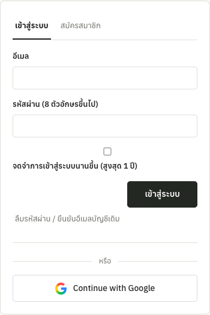
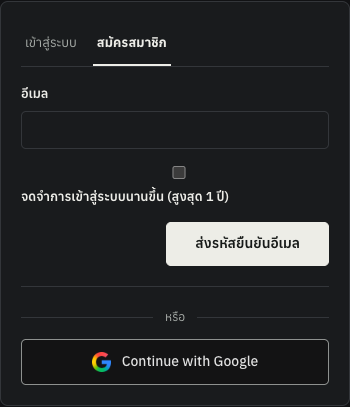

# Google login/register button — local verification

2026-10-18. Replaces the generic sign-in arrow with the official Google G in the
existing shared login/register button. No authentication endpoint, cookie,
provider setting or navigation handler changes.

- `static/index.html`: local image, decorative empty alt text, fixed 20px box;
  styles asset bumped to v25. The existing adjacent button label is retained.
- `static/styles.css`: preserve aspect ratio; remove the obsolete icon color
  rule/token. Both themes keep their existing button styles.
- `static/google-g.png`: unmodified 33,661-byte official asset, with provenance
  in `static/google-g.SOURCE.md`. The supplied 1,208,982-byte local PNG is not
  modified or published. No third-party image request is introduced.
- `tests/test_auth_logo.js`: two regressions for the locally served PNG, button
  label/accessibility, size bound, and absence of color/opacity filters.

## Actual checks

- JavaScript suite: **42 passed, zero skips**. Syntax and DOM/style guards passed.
- Playwright, actual local SPA with mocked anonymous APIs: login at 1280px and
  register at 390px, both light and dark themes. All four cases loaded the logo
  and had no horizontal page overflow; the corrected mock produced zero page
  errors. The first mock incorrectly returned an array for `/api/problems`,
  causing a harness error; corrected it to `{problems: []}` and reran all four.
- Inspected cropped form screenshots below. Zero real OTPs were sent and no real
  OAuth login was attempted. Browser routes were removed after the test.
- This is local verification, not proof of a production release or provider login.

